<p align="center">
  
</p>

<h1 align="center">FinTrack for Deplao</h1>

<p align="center">
  Personal finance <b>inside Deplao</b>: runs on your own Cloudflare account and records expenses from Zalo groups by text, voice note or receipt photo.
</p>

<p align="center"><b>English</b> · <a href="README.md">Tiếng Việt</a></p>

<p align="center">
  <a href="https://github.com/babyvibe/fintrack-deplao-app/actions/workflows/ci.yml"></a>
  <a href="https://github.com/babyvibe/fintrack-deplao-app/releases"></a>
  
  <a href="LICENSE"></a>
</p>

<p align="center">
  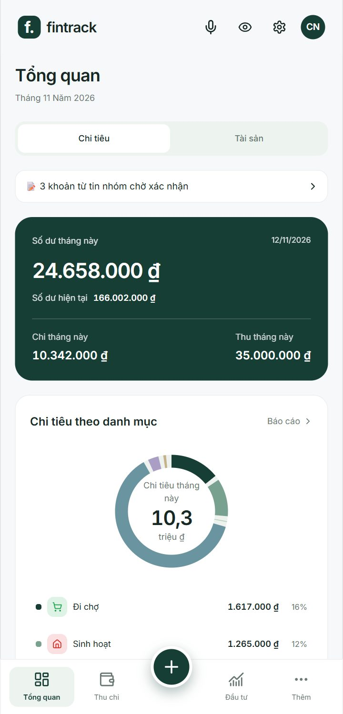
  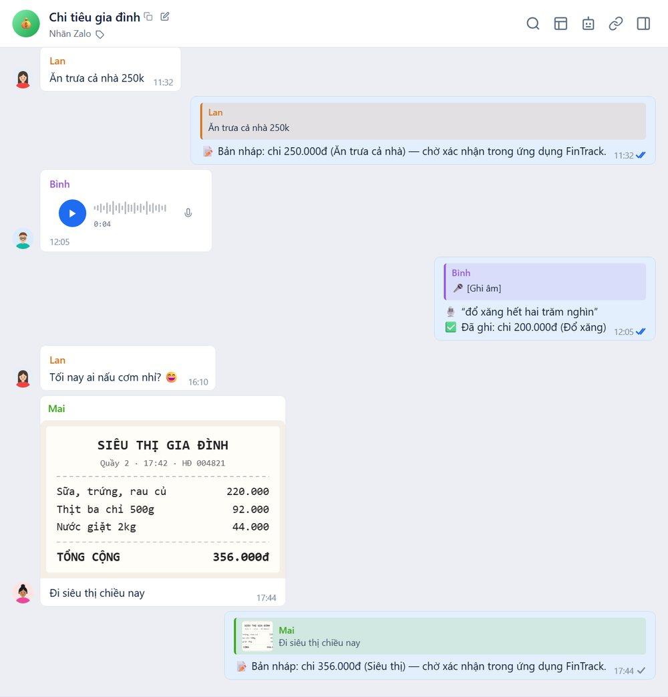
  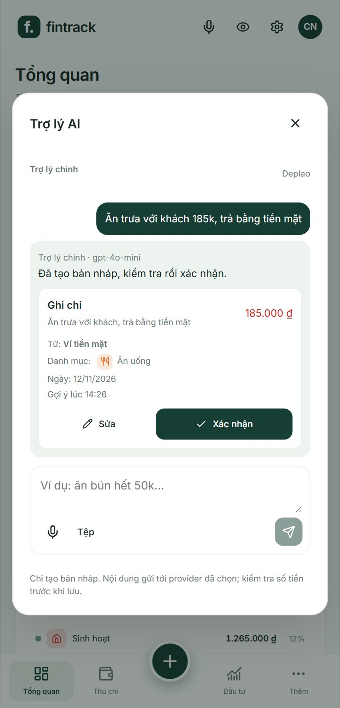
</p>

**FinTrack** is a personal finance app: income and expenses, budgets, investments, savings, reports and an AI
assistant. This app brings **the whole FinTrack** into [Deplao](https://deplaoapp.com) (same UI, API and business rules
as standalone FinTrack) and adds what only Deplao can do: one-click deployment to the Cloudflare account connected in
Deplao, Deplao's AI assistants, and expense capture from Zalo groups.

Open source (MIT). There is no server in the middle: your data lives in your own Cloudflare D1 database.

The app's UI is Vietnamese, the language of Deplao's users. This README and the developer documentation are in English;
the install dialog inside Deplao shows [README.md](README.en.md).

**Building your own Deplao app?** This repository is the reference template: start with
[docs/BUILDING_APPS.md](docs/BUILDING_APPS.md).

## Contents

- [Features](#features)
- [Requirements](#requirements)
- [Install](#install)
- [Using the app](#using-the-app)
- [Workflow nodes](#workflow-nodes)
- [Permissions](#permissions)
- [Privacy and security](#privacy-and-security)
- [FAQ](#faq)
- [Troubleshooting](#troubleshooting)
- [Development](#development)
- [Documentation](#documentation) · [Contributing](#contributing) · [License](#license)

## Features

- **Full FinTrack inside Deplao**: the *FinTrack* page opens the app directly; the same data is available from a
  browser or phone.

- **Monthly views**: the Overview ("Tổng quan") shows this month's balance (income minus spending of the month alone,
  your current total balance in small print). Transactions ("Thu chi") is a calendar of the month or pay cycle with daily
  income and spending; day headings include the weekday, e.g. "7/12/2026 (Thứ 2)". **Category icons** (chosen, or guessed
  from the name) appear everywhere a category does.

- **One-click deployment**: Worker + D1 + Workers AI on the Cloudflare account connected in Deplao (no wrangler; the app
  never sees the Cloudflare token). Updates keep your data and apply only missing migrations, and FinTrack tells you
  when the bundled version is newer than the deployed one.

- **Custom domain**: attach `fintrack.<your-domain>` from the app without opening Cloudflare: pick a subdomain and a zone,
  confirm in Deplao's dialog, Cloudflare creates the DNS record and certificate, and the app switches over once the new
  name answers.

- **AI assistant of your choice**: FinTrack's own assistant (OpenAI / Gemini / DeepSeek keys entered in FinTrack; reads
  receipt photos and voice) **or** one of Deplao's assistants (default or chosen, no extra key). Chosen per account, with
  token usage per assistant for today and this month.

- **Multiple accounts**: one ledger per account; sign up, sign in, **quick switch** between remembered accounts and sign
  out, all inside Deplao. Passwords are never stored.

- **Expenses from Zalo (optional)**: add the FinTrack node to your own workflow (there is no group setup in the app).
  Anyone in the group can post text, voice notes or receipt photos; the assistant creates a **draft awaiting
  confirmation** (default) or **auto-records** clear items, then replies briefly in the group. The sender replies **"ok"**
  to record or **"huỷ"** (cancel) to drop the draft or undo an auto-recorded item:

  ```
  Lan:     Ăn trưa 50k, cafe 25k tiền mặt
  Deplao:  📝 Bản nháp: chi 50.000đ (Ăn trưa), chi 25.000đ (Cafe). Trả lời “ok” để ghi, “huỷ” để bỏ.
  Lan:     ok
  Deplao:  ✅ Đã ghi: chi 50.000đ (Ăn trưa), chi 25.000đ (Cafe)
  Bình:    🎤 (voice note) “đổ xăng hết hai trăm nghìn”          ← auto-record mode
  Deplao:  🎙️ “đổ xăng hết hai trăm nghìn”
           ✅ Đã ghi: chi 200.000đ (Đổ xăng)
           Sai thì trả lời “huỷ”.
  Lan:     🖼️ (supermarket receipt)                               ← needs FinTrack's own assistant to read photos
  Deplao:  📝 Bản nháp: chi 356.000đ (Siêu thị). Trả lời “ok” để ghi, “huỷ” để bỏ.
  ```

  Drafts also wait in FinTrack (Overview → "Chờ xác nhận", pending drafts), on any address of FinTrack.

- **Vietnamese money slang**: "50k", "5 chục", "2 lít", "1 củ", "1 tỏi" and friends are understood by the assistant.

- **Market prices without API keys**: stocks (VNDIRECT) and crypto (Binance, CoinGecko) come from public feeds; the gold
  price key is issued automatically.

- **Open workflow**: the nodes `fintrack.record` and `fintrack.transcribe` work in any workflow (schedules, conditions,
  other nodes); every setting lives in the node.

<table>
  <tr>
    <td align="center" valign="top">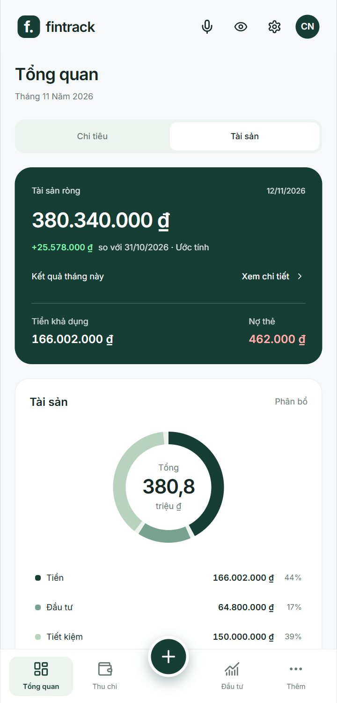<br><sub>Overview · Assets tab</sub></td>
    <td align="center" valign="top">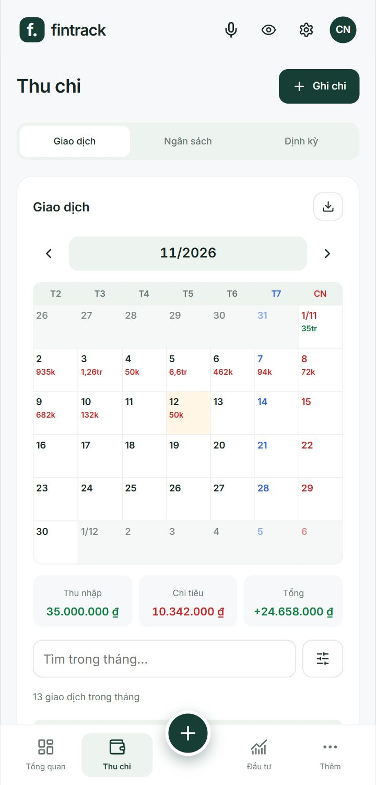<br><sub>Transactions as a monthly calendar</sub></td>
    <td align="center" valign="top">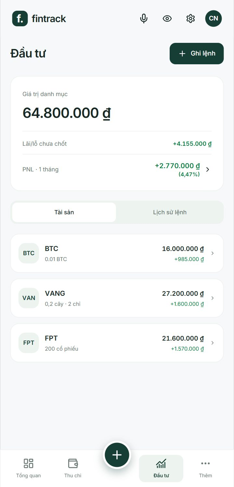<br><sub>Investments: stocks, gold, crypto</sub></td>
    <td align="center" valign="top">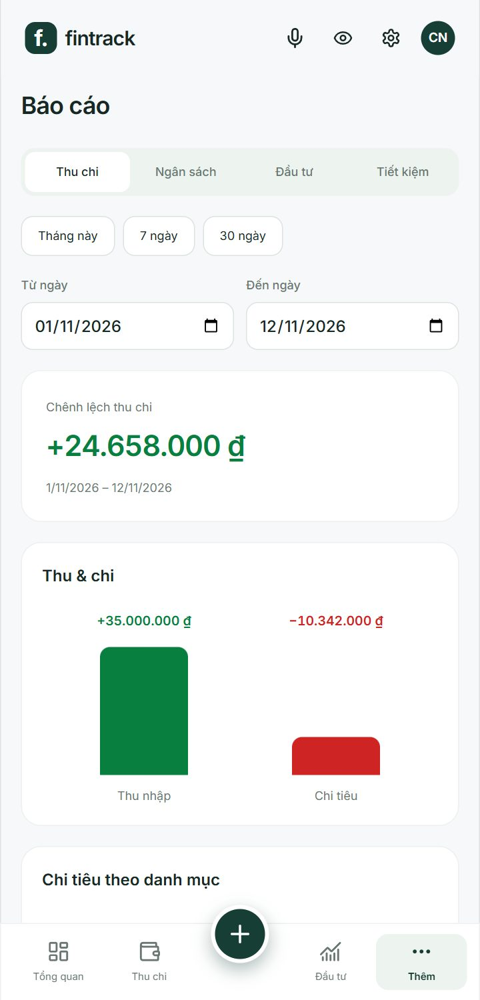<br><sub>Reports: cash flow, budgets, investments</sub></td>
  </tr>
</table>

<sub>Screenshots use FinTrack's demo data ("Nạp dữ liệu mẫu" loads three months of made-up entries up to today). The UI
inside Deplao is the same as standalone FinTrack.</sub>

## Requirements

| You need                                     | Notes                                                                                                                                                                                                                            |
|----------------------------------------------| -------------------------------------------------------------------------------------------------------------------------------------------------------------------------------------------------------------------------------- |
| **Deplao ≥ 26.11.0**                         | First release with Cloudflare deployment for apps, `aiChat` with `raw_system`, message media for apps and the assistant picker in workflow nodes. Custom domains need 26.10.4. Older versions refuse to install the app.         |
| **Cloudflare connected in Deplao**           | Settings → Internet & Cloud → Connect Cloudflare ("Cài đặt → Internet & Đám mây → Kết nối Cloudflare"). The token needs **Account · Workers Scripts · Edit** and **Account · D1 · Edit**; Deplao's token template includes them. |
| **workers.dev enabled** (or a custom domain) | For a FinTrack deployed elsewhere, fill *Địa chỉ FinTrack* (FinTrack address) in the app settings.                                                                                                                               |
| **Workers AI** on Cloudflare                 | Voice to text (Whisper). The free plan has a daily quota.                                                                                                                                                                        |
| **An AI assistant**                          | FinTrack's own (OpenAI / Gemini / DeepSeek key in FinTrack → Settings → AI assistant) **or** one of Deplao's (Integrations → AI assistant). Reading photos needs FinTrack's own assistant (OpenAI, Gemini or DeepSeek Flash).    |
| A Zalo account in Deplao                     | Only to record expenses from Zalo messages (workflow node).                                                                                                                                                                      |

## Install

1. Download `fintrack-<version>.zip` from [Releases](https://github.com/babyvibe/fintrack-deplao-app/releases) and
   check its sha256.
2. In Deplao: **Tools → Apps, API & Webhook → Install app** ("Công cụ → Ứng dụng, API & Webhook → Cài ứng dụng"),
   choose the zip, read and approve the permissions.
3. Open **FinTrack**. The first time you get the setup page: click **"Triển khai FinTrack"** (Deploy FinTrack). If a
   Worker already exists you must tick the update confirmation (D1 data and the secret are kept, only missing migrations
   run).
4. FinTrack opens. A brand new FinTrack asks you to create the first account ("Tạo tài khoản FinTrack"), which becomes
   the admin.

<table>
  <tr>
    <td align="center" valign="top">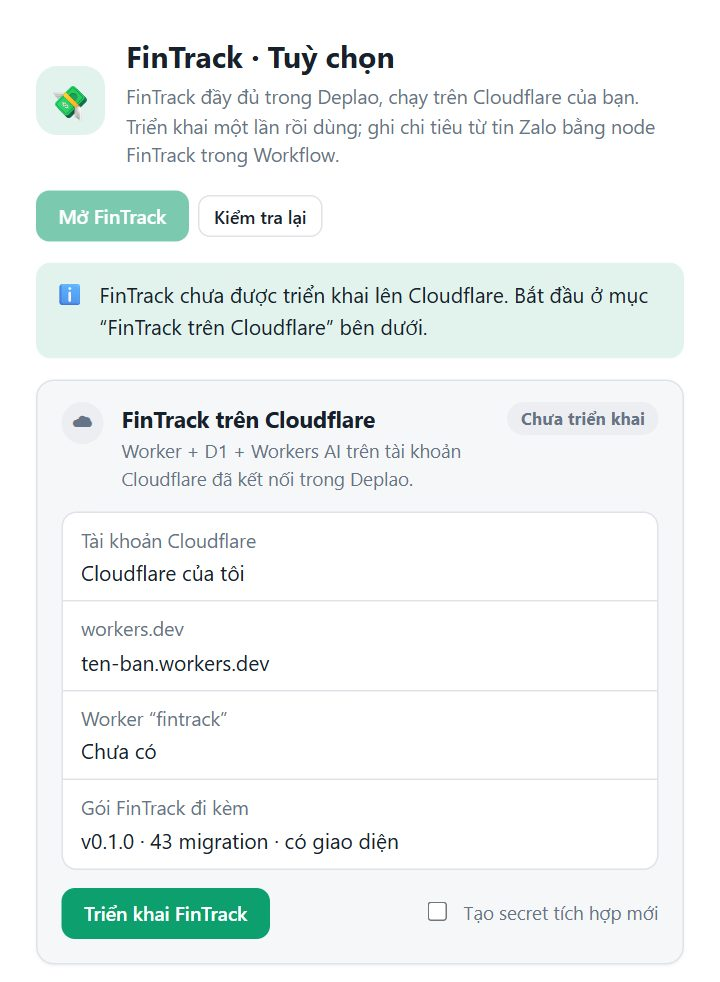<br><sub>1. First-run setup</sub></td>
    <td align="center" valign="top">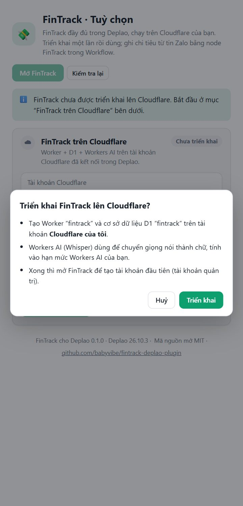<br><sub>2. Confirm deployment</sub></td>
    <td align="center" valign="top">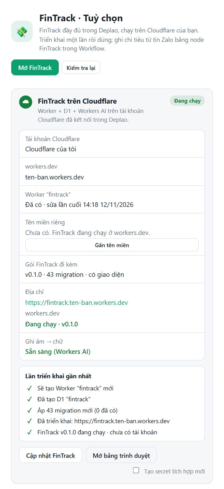<br><sub>3. Deployed</sub></td>
    <td align="center" valign="top">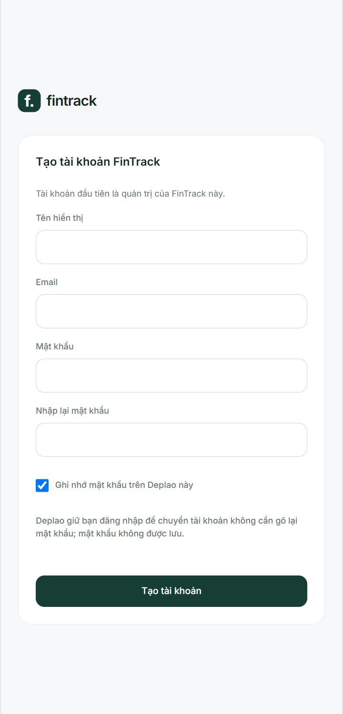<br><sub>4. First account</sub></td>
  </tr>
</table>

**Updating.** Install the new zip over the old one. Installing a new app version does **not** update FinTrack on
Cloudflare: when the Overview shows "Có bản FinTrack mới" (a newer FinTrack is bundled), open the Options page
("Tuỳ chọn") and click **"Cập nhật FinTrack"** (Update FinTrack). Data and the secret are kept, only missing migrations
run; updating an existing Worker asks for confirmation. See the [CHANGELOG](CHANGELOG.md).

**Custom domain** (Deplao 26.10.4+): Options → FinTrack on Cloudflare → *Tên miền riêng* (custom domain) → **Gắn tên
miền** (attach) → type a subdomain (e.g. `fintrack`) and pick a zone of your Cloudflare account → confirm in Deplao's
dialog. Cloudflare creates the DNS record and certificate (usually 1 to 5 minutes); meanwhile FinTrack keeps running on
workers.dev and the app switches over once the new name answers. Only new subdomains without DNS records can be
attached. The *Địa chỉ FinTrack* setting **does not create a domain**: fill it only for a FinTrack you deployed
elsewhere.

<p align="center">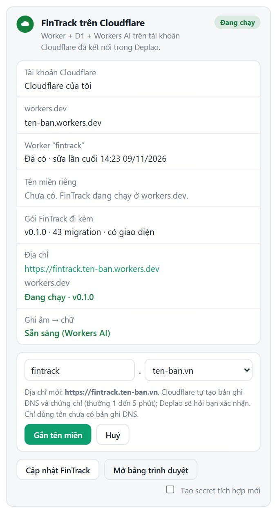<br><sub>Options → FinTrack on Cloudflare → custom domain</sub></p>

<table>
  <tr>
    <td align="center" valign="top">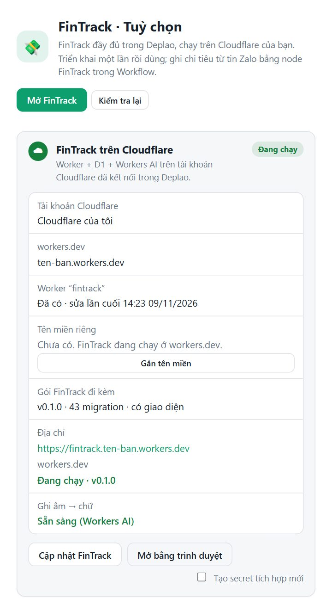<br><sub>Options → FinTrack on Cloudflare</sub></td>
    <td align="center" valign="top">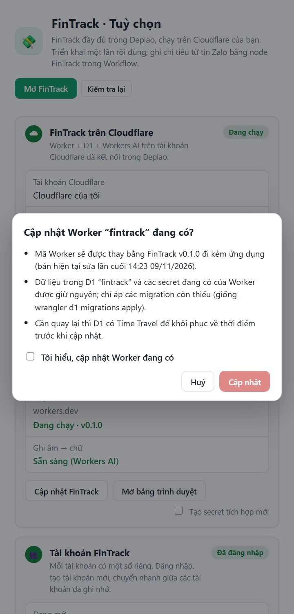<br><sub>Update FinTrack (data kept)</sub></td>
  </tr>
</table>

## Using the app

### Accounts

- **Account button** (initials, top of FinTrack): quick switch between remembered accounts, *Thêm tài khoản* (add an
  account: sign in to another one or **create a new account** with its own ledger), *Đăng xuất* (sign out: back to the
  account picker, no automatic sign-in).
- **"Ghi nhớ mật khẩu trên Deplao này"** (remember on this Deplao, on by default): Deplao keeps that account's session so
  you can switch without typing the password again. The password is **not** stored; forgetting the account (× or
  *Quên*) means signing in again next time.
- The Options page, section *Tài khoản FinTrack* (FinTrack accounts), does the same: open or forget remembered accounts,
  add an account, sign out.
- **Share FinTrack with other people**: Options page → *Chia sẻ FinTrack* (Share FinTrack, at the top) → *Sao chép*
  (copy) the address (your custom domain, otherwise workers.dev) and send it; it works in a browser or on a phone. To let
  them create their own accounts, turn on *Cho người khác tự tạo tài khoản* there (off by default; needs the admin
  account, i.e. the first one, open in Deplao): each person gets their own ledger, *Tối đa tài khoản* caps the number of
  accounts (0 = no limit). While it is off, the address only signs in existing accounts: the admin adds them in FinTrack
  → Settings → **Accounts** and sends the temporary password (shown once), which the user changes at first sign-in.
  Sign-ups per network per hour, AI calls per day, password resets and locking live on that FinTrack page too.

<table>
  <tr>
    <td align="center" valign="top">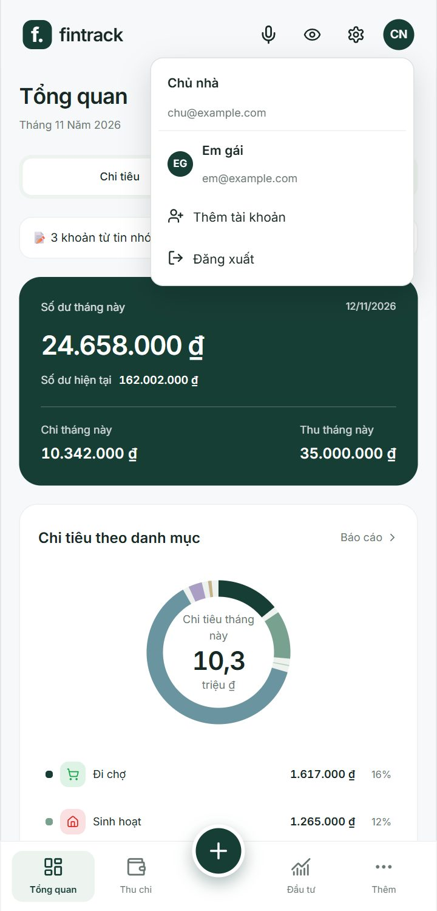<br><sub>Quick switch between accounts</sub></td>
    <td align="center" valign="top">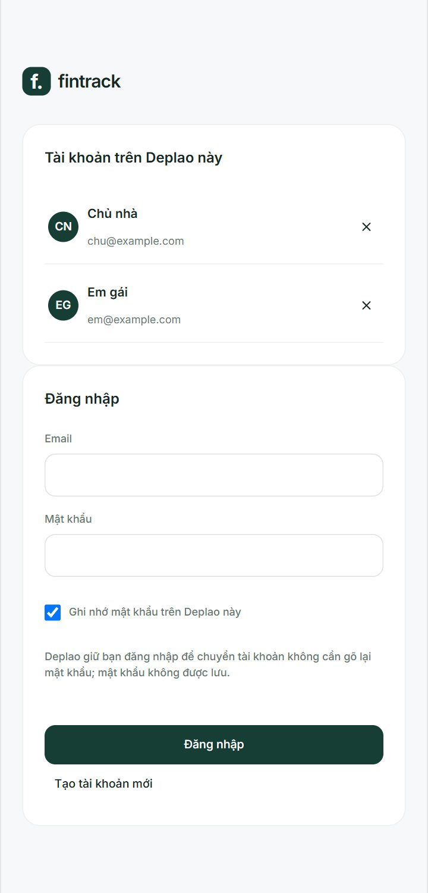<br><sub>Remembered accounts · sign in</sub></td>
    <td align="center" valign="top">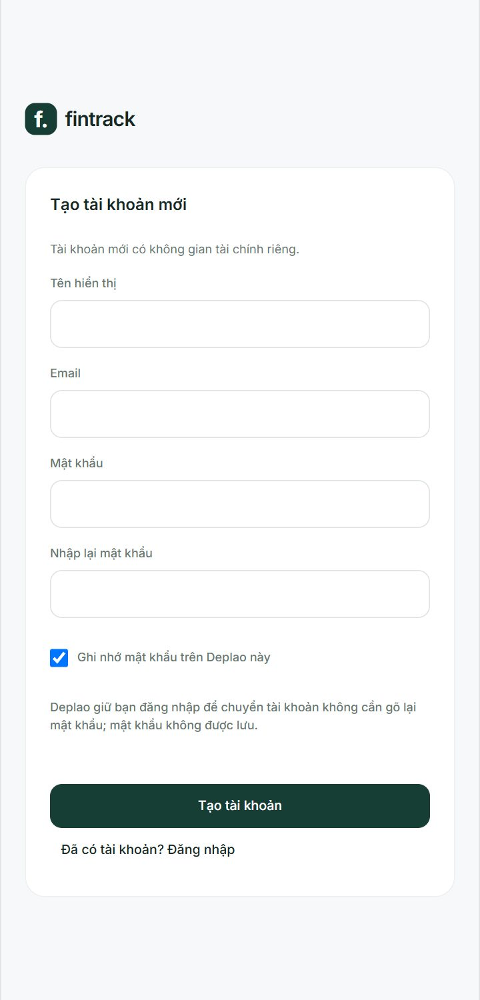<br><sub>New account (own ledger)</sub></td>
    <td align="center" valign="top">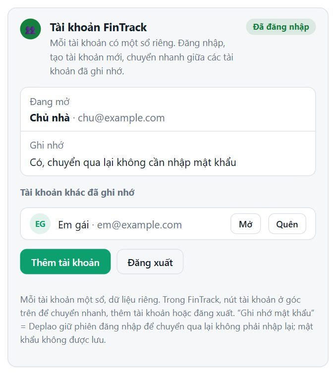<br><sub>Options → Accounts</sub></td>
  </tr>
</table>

### AI assistant

FinTrack → Settings → **AI assistant** ("Trợ lý AI") shows one list:

- **FinTrack's assistants**: the OpenAI / Gemini / DeepSeek profiles you add (API key required). They work exactly as
  in standalone FinTrack: receipt photos, voice per settings, a daily call limit. Gemini keys come from
  [Google AI Studio](https://aistudio.google.com/apikey); the default model is `gemini-3.8-flash`. On Google's free tier
  your content may be used to improve Google's products; on the paid tier it is not.
- **Deplao's assistants**: *Mặc định của Deplao* (Deplao's default) or a specific one. No extra key; text and voice,
  **no photos yet**.

The choice is stored per account and applies both to chat inside FinTrack and to Zalo messages recorded into that
ledger. Every assistant shows its **token usage** (today and this month, with the number of calls), including Deplao's
assistants used from Zalo groups. Tokens are what AI providers bill.

<table>
  <tr>
    <td align="center" valign="top">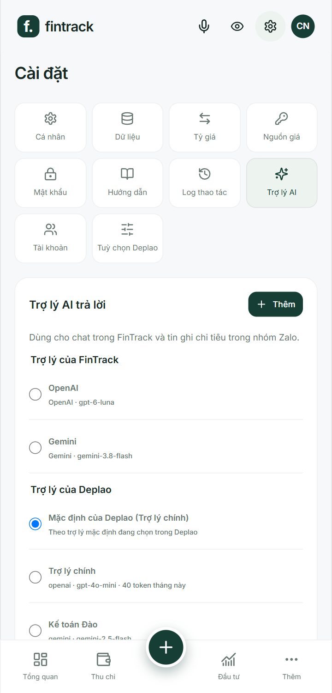<br><sub>Settings → AI assistant</sub></td>
    <td align="center" valign="top"><br><sub>One sentence → a draft, confirm to record</sub></td>
  </tr>
</table>

### Recording expenses from Zalo (optional)

There is no group to pick or create in the app: once FinTrack is deployed, Zalo capture is just a node in Deplao's
**Workflow**.

1. Deplao → **Workflow** → new workflow: a *message* trigger (filtered to the groups or chats to record; text, voice and
   images) → add the node **"FinTrack: ghi chi tiêu từ tin nhắn"** (record expenses from messages).
2. Pick the node settings: **mode** (*draft*, the default, or *auto* for clear items), replies in the group, voice,
   photos, assistant (see [Workflow nodes](#workflow-nodes)).
3. Entries go to the **FinTrack account currently open** in Deplao. Every group member can post; the Zalo account that
   runs the workflow replies like a bot.
4. Confirm in the group: the sender of that item (or you, the ledger owner) **replies to the assistant's message** with
   *ok* (record) or *huỷ* (drop the draft, or reverse an item already recorded). Sending *ok* / *huỷ* right after your own
   message (within 30 minutes) also works without quoting. Missing information (e.g. no category yet) is spelled out.
5. Or in FinTrack: the Overview shows *N khoản từ tin nhóm chờ xác nhận* (N items from group messages awaiting
   confirmation) → **Chờ xác nhận**: fill in what the assistant was unsure about (income or expense, category, wallet,
   date), edit, confirm or skip.

<p align="center">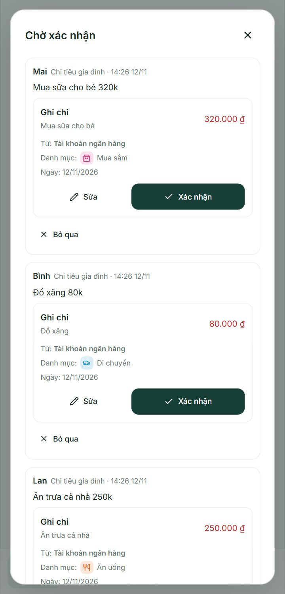<br><sub>FinTrack → Overview → "Chờ xác nhận" (also on a custom domain)</sub></p>

The FinTrack address (for a FinTrack deployed elsewhere) and a self-managed secret are in the app's settings in Deplao.

## Workflow nodes

**`fintrack.record`**, "FinTrack: ghi chi tiêu từ tin nhắn". Text, voice notes or photos go to FinTrack's AI assistant
(one conversation per group, content `Người gửi: <name>\n<message>`) and are recorded into the FinTrack account open in
Deplao.

<p align="center">
  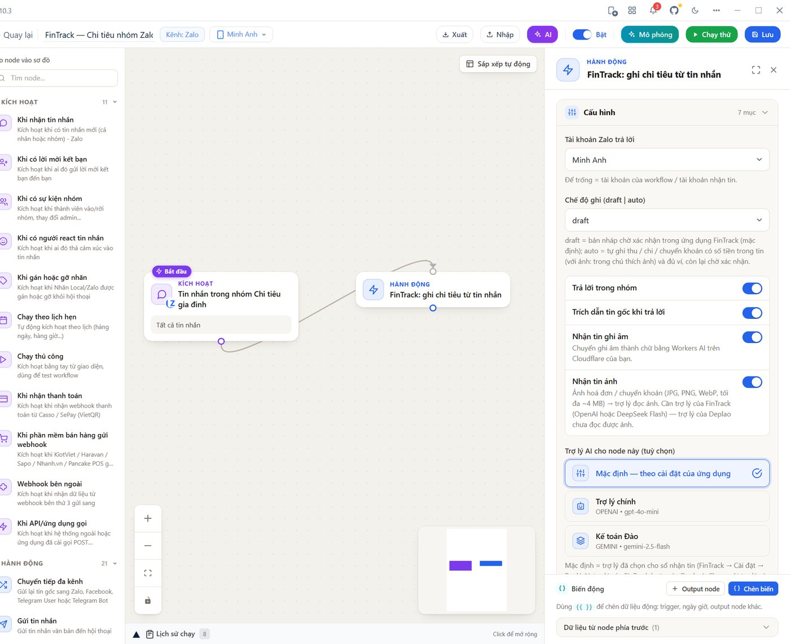
  <br><sub>The FinTrack node in Deplao's workflow editor: add and edit it like any other node.</sub>
</p>

| Setting        | Default          | Meaning                                                                                                                                                                                                                                                                                                                                       |
| -------------- | ---------------- | --------------------------------------------------------------------------------------------------------------------------------------------------------------------------------------------------------------------------------------------------------------------------------------------------------------------------------------------- |
| `account`      | workflow account | Zalo account that replies.                                                                                                                                                                                                                                                                                                                    |
| `mode`         | `draft`          | `draft`: drafts await confirmation ("ok" in the group, or "Chờ xác nhận" in FinTrack). `auto`: records income / expense / transfer items whose amount appears in the message (for photos: in the caption), with wallet and category, and nothing the assistant was unsure about; reply "huỷ" to undo. Everything else waits for confirmation. |
| `replyInGroup` | `true`           | Reply in the group (📝 / ✅ / ❓ / ↩️).                                                                                                                                                                                                                                                                                                         |
| `quoteReply`   | `true`           | Quote the original message.                                                                                                                                                                                                                                                                                                                   |
| `voice`        | `true`           | Accept voice notes.                                                                                                                                                                                                                                                                                                                           |
| `images`       | `true`           | Accept photos (JPG / PNG / WebP up to about 4 MB); needs FinTrack's own assistant to read photos.                                                                                                                                                                                                                                             |
| `assistantId`  | *Default*        | Assistant picker: *Default* = the assistant chosen for the ledger; picking one of Deplao's assistants makes the node always use it (no photos).                                                                                                                                                                                               |

Outputs: `recorded` (items recorded), `drafts` (items awaiting confirmation), `items`, `text`, `reply`, `skipped`: empty
when handled, otherwise the reason: `no_message`, `no_amount`, `not_transaction`, `unclear`, `duplicate`, `own_reply`,
`voice_disabled`, `voice_failed`, `empty_transcript`, `images_disabled`, `image_unsupported_ai`, `image_failed`,
`unsupported_message`, `ai_error`, `fintrack_error`, `not_configured`, `not_allowed` / `already` / `draft_gone` (an
"ok" / "huỷ" that could not apply), `internal_error` (unexpected; see the app's log in Deplao).

- Text messages that do not mention money are skipped right away (no AI call, nothing stored).
- "ok" / "huỷ" are commands only when they are the whole message (polite endings like "ạ", "nhé" are fine). A reply that
  quotes the assistant's message also accepts short answers ("ừ", "đúng", "sai", 👍); without a quote only unambiguous
  words count, applied to the sender's latest message. Other members replying to the assistant are told that only the
  sender or the ledger owner can confirm.
- Each Zalo message is handled once (remembered for 7 days), even when several of your Zalo accounts are in the group.
- The app's own replies (✅ ❓ ⚠️ 🎙️ 📝 ↩️) are never processed again.
- Temporary errors (FinTrack or the assistant not answering) are reported in the group at most once every 10 minutes.
  Setup problems (not deployed, wrong secret, ...) are skipped silently; the Options page shows them to you.

**`fintrack.transcribe`**, "FinTrack: ghi âm thành chữ" (voice to text with Workers AI Whisper). Outputs `text`,
`durationSec`, `skipped`.

## Permissions

| Permission                                              | Used for                                                                                                                                                        |
| ------------------------------------------------------- | --------------------------------------------------------------------------------------------------------------------------------------------------------------- |
| `cloudflare:workers`                                    | Deploy the Worker + D1 named `fintrack` (only resources carrying the app's name); attach a subdomain to that Worker after you agree in Deplao's dialog.         |
| `network`                                               | Call your FinTrack Worker; download voice notes / photos from Zalo's CDN when Deplao has not downloaded them.                                                   |
| `storage`                                               | FinTrack address, integration secret, sessions per account, remembered accounts, assistant choice, which group reply belongs to which draft (for "ok" / "huỷ"). |
| `ui:pages`                                              | The "FinTrack" page.                                                                                                                                            |
| `ui:microphone`                                         | Recording when you press the microphone in FinTrack's AI assistant (only inside the app's frame).                                                               |
| `ai:use`                                                | Calling Deplao's assistant and listing assistants to choose from.                                                                                               |
| `workflow:nodes`                                        | The nodes `fintrack.record` and `fintrack.transcribe` (the app never creates or edits your workflows).                                                          |
| `accounts:read`, `chat:read`, `chat:send`, `media:read` | Recognise the app's own replies, read and download voice notes / photos, reply in the group.                                                                    |

## Privacy and security

- No server in the middle: UI → the app's backend (on your machine) → your FinTrack Worker (HTTPS).
- AI: FinTrack builds the prompt and context as in standalone FinTrack. FinTrack's own assistant calls OpenAI / Gemini /
  DeepSeek directly from your Worker; with Deplao's assistant the prompt goes through the app's backend to Deplao. Every
  entry still goes through FinTrack's business API (wallet, category and amount are checked again).
- Voice: Deplao downloads it → your Worker → Workers AI on your Cloudflare. Photos: Deplao downloads them → your Worker →
  the AI provider of FinTrack's assistant. Audio and images are not stored.
- The integration secret and session tokens stay in the app's private storage on your machine, never shown in the UI or
  logged; passwords are never stored; the app never sees the Cloudflare token.

Details and how to report a vulnerability: [SECURITY.md](SECURITY.md).

## FAQ

**Does it cost anything?** The app is free. FinTrack runs on your Cloudflare account; personal or family use usually fits
the free plans. Cloudflare pricing as of October 2026: [D1](https://developers.cloudflare.com/d1/platform/pricing/) has 5
million rows read and 100,000 rows written per day and 5 GB storage for free;
[Workers AI](https://developers.cloudflare.com/workers-ai/platform/pricing/) has 10,000 neurons per day for free (about
200 minutes of Whisper); [Workers](https://developers.cloudflare.com/workers/platform/pricing/) has a free daily request
quota. Daily quotas reset at 07:00 Vietnam time. AI: FinTrack's own assistant bills your OpenAI / Gemini / DeepSeek key;
Deplao's assistant uses the AI setup you already have in Deplao.

**Where is my data?** The ledger lives in the D1 database `fintrack` on your Cloudflare account. Your machine only keeps
the app's configuration (address, integration secret, sessions, remembered accounts, which reply belongs to which draft)
in the app's private storage in Deplao; drafts from groups live in D1 with the ledger. No server of the author sits in
between.

**Can I use it in a browser or on my phone?** Yes: open the Worker address (*Mở bằng trình duyệt*, open in browser, on
the Options page) and install it as an app (PWA). Same data as in Deplao.

**What happens when I uninstall?** Deplao asks *Giữ dữ liệu* (keep data: reinstall and continue) or *Xoá dữ liệu*
(delete the local configuration: secret, sessions, remembered accounts). Neither touches Cloudflare: the Worker and the
D1 `fintrack` stay and still work in a browser. To delete the ledger for good, back it up first (FinTrack → Settings →
Data → Backup), then delete the Worker `fintrack` and the D1 `fintrack` in the Cloudflare dashboard. Workflows with the
FinTrack node stay in Deplao: disable or delete them on the Workflow page.

**Can my family share it?** One account per person (each with its own ledger): on the Options page, *Chia sẻ FinTrack*
→ copy the address, send it, and turn on *Cho người khác tự tạo tài khoản* so each person creates their own account.
For shared household spending use one Zalo group through the FinTrack node: it records into the account open in
Deplao, from anyone in the group, with the sender's name.

**The numbers differ from my wallet / bank / card statement?** Transactions → *Ghi chi* → *Điều chỉnh* tab (balance
adjustment; or Accounts → ⋯ → *Điều chỉnh số dư*): enter the real balance and FinTrack records the difference. An
adjustment is neither income nor spending and never touches budgets; cancel a wrong one from Transactions.

**I loaded the demo data, how do I start for real?** FinTrack → Settings → Data → *Đặt lại toàn bộ dữ liệu* (reset all
data): deletes every financial record of the open account (wallets, transactions, investments, savings, budgets,
assistant chat, ...), keeps sign-in, settings and AI assistants, then shows the first-wallet screen. Other accounts are
untouched. It cannot be undone: download a backup first if needed.

## Troubleshooting

| Symptom                                                                                                                               | What to do                                                                                                                                                                                                                                    |
| ------------------------------------------------------------------------------------------------------------------------------------- | --------------------------------------------------------------------------------------------------------------------------------------------------------------------------------------------------------------------------------------------- |
| "Gói FinTrack đi kèm thiếu giao diện (vendor/fintrack/app)" (bundled FinTrack has no UI)                                              | Install the full release zip from the Releases page, not the source code.                                                                                                                                                                     |
| "Bản Deplao đang dùng chưa hỗ trợ triển khai lên Cloudflare" / the app does not install                                               | Update Deplao.                                                                                                                                                                                                                                |
| "Token Cloudflare còn thiếu quyền …" (the token lacks permissions)                                                                    | Create the token again with the template link in Connect Cloudflare. Deplao caches the check for about a minute.                                                                                                                              |
| The Overview says "Có bản FinTrack mới", or new features do not work (category icons are not saved, the calendar has no daily totals) | The FinTrack bundled in the app is newer than the one on Cloudflare (installing a new app version does not update Cloudflare). Options → **Cập nhật FinTrack**; data is kept.                                                                 |
| "Chưa kết nối được FinTrack" (cannot reach FinTrack) right after deploying                                                            | A newly enabled workers.dev can take a few minutes. Click *Kiểm tra lại* (check again).                                                                                                                                                       |
| A domain typed into *Địa chỉ FinTrack* does not work                                                                                  | That setting does not create a domain (and one typo breaks it). Clear it, then attach the domain in Options → FinTrack on Cloudflare → custom domain.                                                                                         |
| Attaching a domain says it "already has DNS records" or "is used by another Worker"                                                   | That subdomain is used for something else (a website, Deplao's Internet address, ...): pick another name or delete that record in Cloudflare first.                                                                                           |
| The custom domain stays at "Chờ DNS và chứng chỉ" (waiting for DNS and certificate)                                                   | Cloudflare usually needs 1 to 5 minutes. Click *Kiểm tra* next to the domain; FinTrack keeps running on workers.dev meanwhile.                                                                                                                |
| The custom domain row asks to update Deplao                                                                                           | Your Deplao predates custom domains: update to 26.10.4 or later.                                                                                                                                                                              |
| FinTrack opens on the sign-in screen                                                                                                  | You signed out, or FinTrack has several accounts and none is remembered on this Deplao: pick a remembered account, sign in, or create a new account.                                                                                          |
| "Tài khoản chủ workspace đã bị khoá" (the ledger owner is locked)                                                                     | An admin locked the account: unlock it in FinTrack → Settings → Accounts (signed in as admin), or use another account.                                                                                                                        |
| The AI assistant reports an error                                                                                                     | Check which assistant is in use (FinTrack → Settings → AI assistant). Deplao's: enabled and with an API key in Integrations → AI assistant. FinTrack's: API key and model in FinTrack → Settings → AI assistant. Or choose another assistant. |
| The group gets "⚠️ … chưa đọc được ảnh" (cannot read photos)                                                                          | The ledger uses Deplao's assistant (or a DeepSeek model other than Flash): choose a FinTrack assistant that reads photos, or type the expense.                                                                                                |
| The group gets "⚠️ Trợ lý AI đã hết lượt hôm nay…" (daily limit reached)                                                              | FinTrack's daily AI call limit (Settings → AI assistant) or the provider's rate limit. Wait or raise the limit.                                                                                                                               |
| The group gets "⚠️ Trợ lý AI của sổ chưa sẵn sàng…" (assistant not ready)                                                             | The chosen FinTrack assistant has no API key: add one in FinTrack → Settings → AI assistant, or choose another assistant for that ledger.                                                                                                     |
| Photos posted in the group do nothing                                                                                                 | The node's *images* setting is off or the workflow trigger does not accept images: fix the workflow. The ledger also needs a FinTrack assistant that reads photos.                                                                            |
| "Dữ liệu FinTrack trả về lớn hơn 5 MB" (response larger than 5 MB)                                                                    | Do large jobs (backup, export) in FinTrack in a browser.                                                                                                                                                                                      |
| The group gets no answer                                                                                                              | Is the workflow with the FinTrack node enabled? Is the Zalo account connected? Is a FinTrack account open in Deplao? Text without an amount is skipped on purpose.                                                                            |

## Development

No dependencies: **Node ≥ 20** is enough, no `npm install`.

```bash
npm test             # all unit tests (node:test, no Deplao, no network)
npm run validate     # manifest, matching versions, every JSON file
npm run check        # both of the above
npm run pack         # → dist/fintrack-<version>.zip  (-- --no-bundle: test package without FinTrack)
```

Try it inside Deplao: **Tools → Apps, API & Webhook → Develop apps → Add a folder in development**, pick the repository
folder. Deplao reloads the backend when `backend/` changes; reload the page after editing `ui/`.

```
backend/            the app process (CommonJS, Node built-in modules only)
  index.js          entry point: nodes + commands
  lib/              proxy, accounts, UI commands, the Zalo recording node, deployment, storage, ...
ui/                 entry page + Options page (plain HTML/CSS/JS, no inline scripts)
vendor/fintrack/    prebuilt FinTrack bundle (not committed, see below)
scripts/            packaging, manifest checks, vendoring FinTrack, end-to-end test, preview, screenshots
test/               node:test + fakes of Deplao / FinTrack (test/helpers/fakes.js)
docs/               BUILDING_APPS.md, ARCHITECTURE.md, CONTRACTS.md (contract between Deplao, FinTrack and the app)
```

**The bundled FinTrack.** A release contains a build of [FinTrack](https://github.com/babyvibe/fintrack) (Worker, web UI,
D1 migrations, the Deplao flavour of the UI) in `vendor/fintrack/`; that folder is not in git. To deploy while
developing, either:

- build FinTrack (`npm run bundle:deplao` in the FinTrack repository), then `npm run vendor`
  (see [vendor/fintrack/README.md](vendor/fintrack/README.md));
- or take it from a release: unzip `fintrack-<version>.zip`, then
  `npm run vendor -- --from <unzipped folder>/vendor/fintrack`.

Without the bundle, tests and UI / node work run normally.

**End-to-end test and preview** (need the FinTrack sources in `../fintrack` or `FINTRACK_DIR`, after `npm install`
there):

```bash
npm run e2e                  # the REAL FinTrack (API + D1 in Miniflare) + a fake Deplao: proxy, accounts, assistant, group node
npm run preview              # the UI at http://127.0.0.1:4319 with a fake Deplao SDK
                             #   -- --fresh: FinTrack without accounts · --demo: demo data + drafts from a Zalo group
                             #   -- --undeployed: first install (click "Triển khai FinTrack")
npm run shots                # regenerate docs/images/*.jpg (Node ≥ 22 + Chrome / Edge)
```

`docs/images/zalo-group.jpg` and `deplao-workflow.jpg` are taken from Deplao's own UI (demo data); every other image is
produced by `npm run shots` from the preview. The address it shows is `fintrack.ten-ban.workers.dev`, not a real Worker.

## Documentation

| Document                                       | For                                                                                 |
| ---------------------------------------------- | ----------------------------------------------------------------------------------- |
| [docs/BUILDING_APPS.md](docs/BUILDING_APPS.md) | Building a new Deplao app with this repository as the template.                     |
| [docs/ARCHITECTURE.md](docs/ARCHITECTURE.md)   | How the app works: processes, modules, sessions, assistant, workflow node, storage. |
| [docs/CONTRACTS.md](docs/CONTRACTS.md)         | The contract between Deplao, FinTrack and this app (APIs, headers, bundle format).  |
| [CONTRIBUTING.md](CONTRIBUTING.md)             | Conventions, local setup, releases.                                                 |
| [SECURITY.md](SECURITY.md)                     | Threat model and how to report a vulnerability.                                     |
| [CHANGELOG.md](CHANGELOG.md)                   | Release notes.                                                                      |

## Contributing

Issues and pull requests are welcome: read [CONTRIBUTING.md](CONTRIBUTING.md) (conventions, local runs, releases) and
the [CODE_OF_CONDUCT.md](CODE_OF_CONDUCT.md). Report security issues privately as described in
[SECURITY.md](SECURITY.md).

## License

[MIT](LICENSE) © 2026 babyvibe. Releases include the FinTrack bundle (MIT) and the licenses of its third-party libraries
in `vendor/fintrack/` (`LICENSE`, `THIRD_PARTY_NOTICES.md`, `THIRD_PARTY_LICENSES.md`).
