<p align="center">
  
</p>

<h1 align="center">FinTrack cho Deplao</h1>

<p align="center">
  Quản lý tài chính cá nhân <b>ngay trong Deplao</b>: chạy trên Cloudflare của chính bạn, ghi chi tiêu từ nhóm Zalo bằng chữ, ghi âm hoặc ảnh hoá đơn.
</p>

<p align="center"><a href="README.en.md">English</a> · <b>Tiếng Việt</b></p>

<p align="center">
  <a href="https://github.com/babyvibe/fintrack-deplao-app/actions/workflows/ci.yml"></a>
  <a href="https://github.com/babyvibe/fintrack-deplao-app/releases"></a>
  
  <a href="LICENSE"></a>
</p>

<p align="center">
  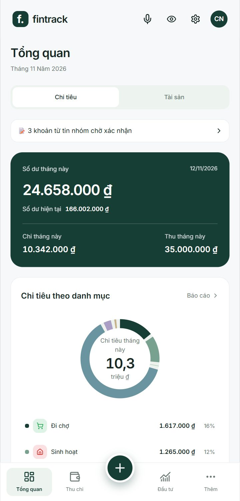
  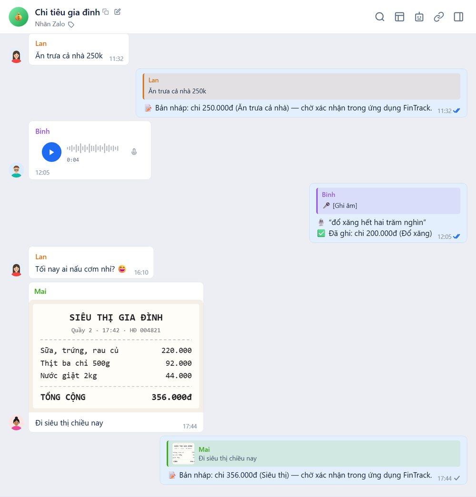
  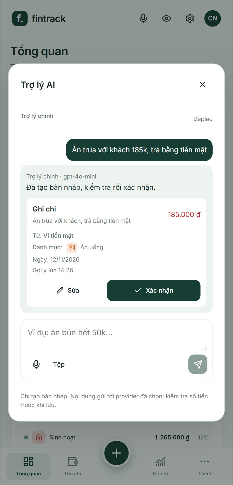
</p>

**FinTrack** là app quản lý tài chính cá nhân (thu chi, ngân sách, đầu tư, tiết kiệm, báo cáo, trợ lý AI). Ứng dụng
này đưa **nguyên FinTrack** vào Deplao (cùng giao diện, cùng API, cùng nghiệp vụ với FinTrack chạy riêng) và thêm phần
tích hợp mà chỉ Deplao làm được: triển khai một chạm lên Cloudflare đã kết nối, dùng trợ lý AI của Deplao, và ghi chi tiêu
từ nhóm Zalo.

Mã nguồn mở (MIT). Không có máy chủ trung gian: dữ liệu nằm trong Cloudflare D1 của bạn.

## Mục lục

- [Tính năng](#tính-năng)
- [Yêu cầu](#yêu-cầu)
- [Cài đặt](#cài-đặt)
- [Hướng dẫn sử dụng](#hướng-dẫn-sử-dụng)
- [Node workflow](#node-workflow)
- [Quyền ứng dụng xin](#quyền-ứng-dụng-xin)
- [Quyền riêng tư & bảo mật](#quyền-riêng-tư--bảo-mật)
- [Câu hỏi thường gặp](#câu-hỏi-thường-gặp)
- [Xử lý sự cố](#xử-lý-sự-cố)
- [Phát triển](#phát-triển)
- [Đóng góp](#đóng-góp) · [Giấy phép](#giấy-phép) · [English](README.md)

## Tính năng

- **FinTrack đầy đủ trong Deplao**: mở trang *FinTrack* là vào thẳng app; dữ liệu giữ nguyên khi mở bằng trình duyệt /
  điện thoại.
- **Thu chi dạng lịch** theo tháng (theo chu kỳ tháng): mỗi ngày có tổng thu, chi; tiêu đề ngày ghi thứ (vd 7/12/2026
  (Thứ 2)). **Biểu tượng danh mục** tự chọn hoặc tự đoán theo tên, hiện ở mọi nơi có danh mục. Giá chứng khoán và
  crypto lấy từ nguồn công khai, không cần API key.
- **Triển khai một chạm**: Worker + D1 + Workers AI lên tài khoản Cloudflare đã kết nối trong Deplao (không cần
  wrangler, ứng dụng không bao giờ thấy token Cloudflare). Cập nhật giữ nguyên dữ liệu, chỉ áp migration còn thiếu.
- **Tên miền riêng**: gắn `fintrack.<tên miền của bạn>` ngay trong ứng dụng, không cần mở Cloudflare: chọn tên con và
  tên miền, Deplao hỏi bạn xác nhận, Cloudflare tự tạo DNS và chứng chỉ; tên mới trả lời được thì ứng dụng tự chuyển sang.
- **Trợ lý AI tuỳ chọn**: dùng trợ lý của chính FinTrack (OpenAI / Gemini / DeepSeek bạn nhập trong FinTrack: đọc ảnh hoá đơn,
  ghi âm) **hoặc** trợ lý AI của Deplao (mặc định / trợ lý bạn chọn, không cần key riêng). Chọn riêng cho từng tài khoản; mỗi trợ lý hiện số token đã dùng
  hôm nay và tháng này.
- **Nhiều tài khoản**: mỗi tài khoản một sổ riêng; tạo tài khoản, đăng nhập, **chuyển nhanh** giữa các tài khoản đã
  *ghi nhớ mật khẩu*, đăng xuất, ngay trong Deplao. Mật khẩu không bao giờ được lưu.
- **Ghi chi tiêu từ tin Zalo (tuỳ chọn)**: thêm node FinTrack vào workflow của bạn (không có bước thiết lập nhóm):
  ai trong nhóm nhắn, gửi ghi âm hay ảnh hoá đơn, trợ lý tạo **bản nháp chờ xác nhận** (mặc định) hoặc **tự ghi**
  khoản chắc chắn rồi trả lời ngắn trong nhóm. Người gửi trả lời **“ok”** để ghi, **“huỷ”** để bỏ (hoặc huỷ khoản vừa
  tự ghi), ngay trong nhóm:

  ```
  Lan:     Ăn trưa 50k, cafe 25k tiền mặt
  Deplao:  📝 Bản nháp: chi 50.000đ (Ăn trưa), chi 25.000đ (Cafe). Trả lời “ok” để ghi, “huỷ” để bỏ.
  Lan:     ok
  Deplao:  ✅ Đã ghi: chi 50.000đ (Ăn trưa), chi 25.000đ (Cafe)
  Bình:    🎤 (ghi âm) “đổ xăng hết hai trăm nghìn”            ← chế độ tự ghi
  Deplao:  🎙️ “đổ xăng hết hai trăm nghìn”
           ✅ Đã ghi: chi 200.000đ (Đổ xăng)
           Sai thì trả lời “huỷ”.
  Lan:     🖼️ (ảnh hoá đơn siêu thị)                           ← cần trợ lý của FinTrack đọc được ảnh
  Deplao:  📝 Bản nháp: chi 356.000đ (Siêu thị). Trả lời “ok” để ghi, “huỷ” để bỏ.
  ```

  Bản nháp cũng nằm trong FinTrack (**Tổng quan → Chờ xác nhận**), mở bằng tên miền riêng hay điện thoại đều thấy.

- **Workflow mở**: node `fintrack.record` và `fintrack.transcribe` dùng được trong workflow của bạn (khung giờ, điều
  kiện, node khác…); mọi cấu hình nằm trong node.

<table>
  <tr>
    <td align="center" valign="top">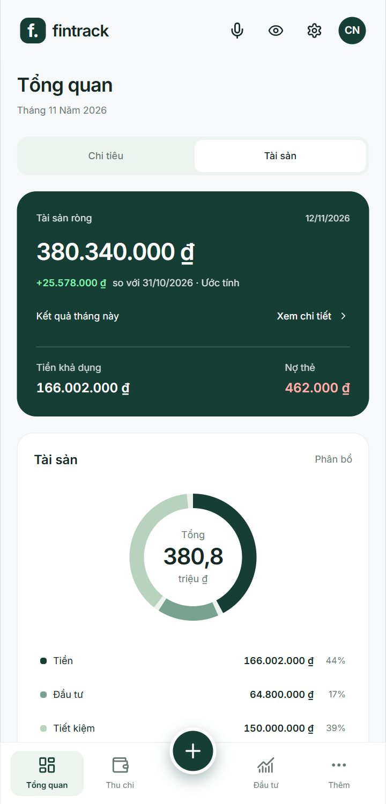<br><sub>Tổng quan · tab Tài sản</sub></td>
    <td align="center" valign="top">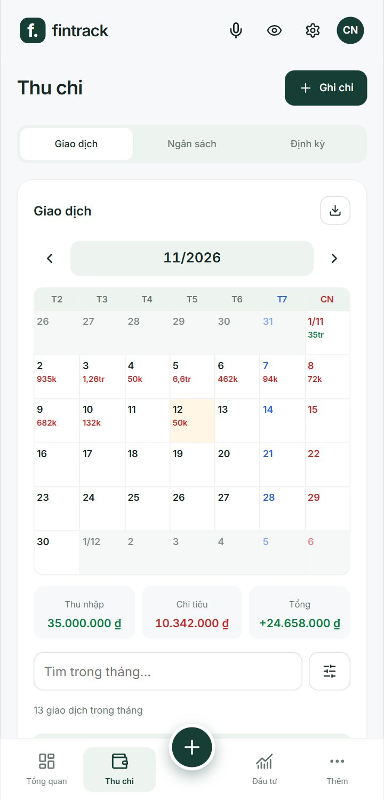<br><sub>Thu chi theo lịch tháng</sub></td>
    <td align="center" valign="top">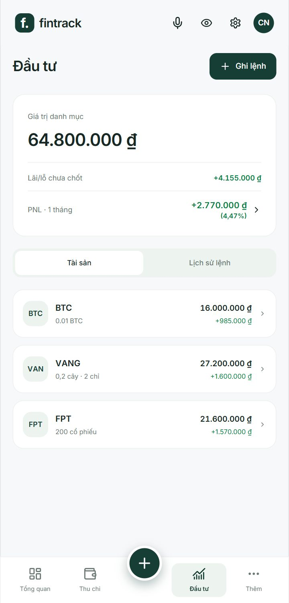<br><sub>Đầu tư: cổ phiếu, vàng, crypto</sub></td>
    <td align="center" valign="top">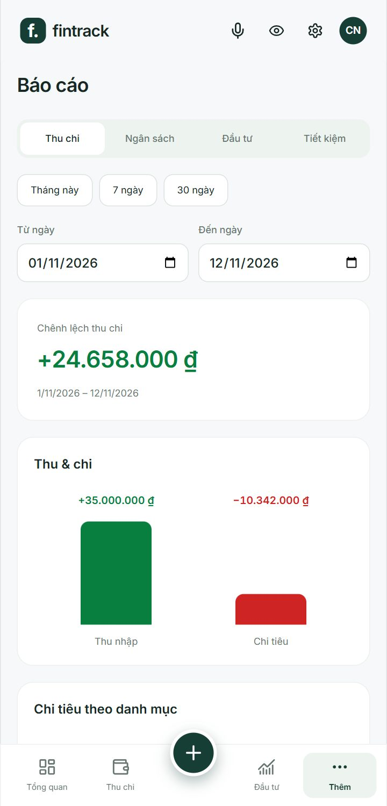<br><sub>Báo cáo thu chi, ngân sách, đầu tư</sub></td>
  </tr>
</table>

<sub>Ảnh chụp dùng dữ liệu mẫu của FinTrack (không phải dữ liệu thật). Giao diện trong Deplao giống hệt FinTrack chạy riêng.</sub>

## Yêu cầu

| Cần có | Ghi chú |
|---|---|
| **Deplao ≥ 26.11.0** | Bản có ứng dụng triển khai Cloudflare, `aiChat` `raw_system`, đọc file tin nhắn cho ứng dụng, ô chọn trợ lý cho node. Bản cũ hơn không cài được ứng dụng. |
| **Cloudflare đã kết nối trong Deplao** | Cài đặt → Internet & Đám mây → Kết nối Cloudflare. Token cần thêm **Account · Workers Scripts · Edit** và **Account · D1 · Edit** (link tạo token mẫu có sẵn trong Deplao). |
| **workers.dev đã bật** (hoặc tên miền riêng) | Tên miền riêng: điền *Địa chỉ FinTrack* trong Cài đặt ứng dụng. |
| **Workers AI** trên Cloudflare | Chuyển giọng nói → chữ (Whisper). Gói miễn phí có hạn mức / ngày. |
| **Một trợ lý AI** | Trợ lý của FinTrack (API key OpenAI / Gemini / DeepSeek, nhập trong FinTrack → Cài đặt → Trợ lý AI) **hoặc** một trợ lý trong Deplao (Tích hợp → Trợ lý AI). Đọc ảnh cần trợ lý của FinTrack (OpenAI, Gemini hoặc DeepSeek Flash). |
| Tài khoản Zalo trong Deplao | Chỉ cần khi ghi chi tiêu từ tin Zalo (node workflow). |

## Cài đặt

1. Tải `fintrack-<phiên bản>.zip` ở [trang phát hành](https://github.com/babyvibe/fintrack-deplao-app/releases)
   (đối chiếu sha256 ghi kèm).
2. Deplao: **Công cụ → Ứng dụng, API & Webhook → Cài ứng dụng** → chọn file zip → đọc và duyệt quyền.
3. Mở **FinTrack**. Lần đầu là trang thiết lập: bấm **Triển khai FinTrack**. Worker đã có thì phải tick xác nhận cập
   nhật (dữ liệu D1 và secret giữ nguyên, chỉ áp migration còn thiếu).
4. Xong là vào thẳng FinTrack. FinTrack mới → màn **Tạo tài khoản FinTrack** (tài khoản đầu tiên là quản trị).

<table>
  <tr>
    <td align="center" valign="top">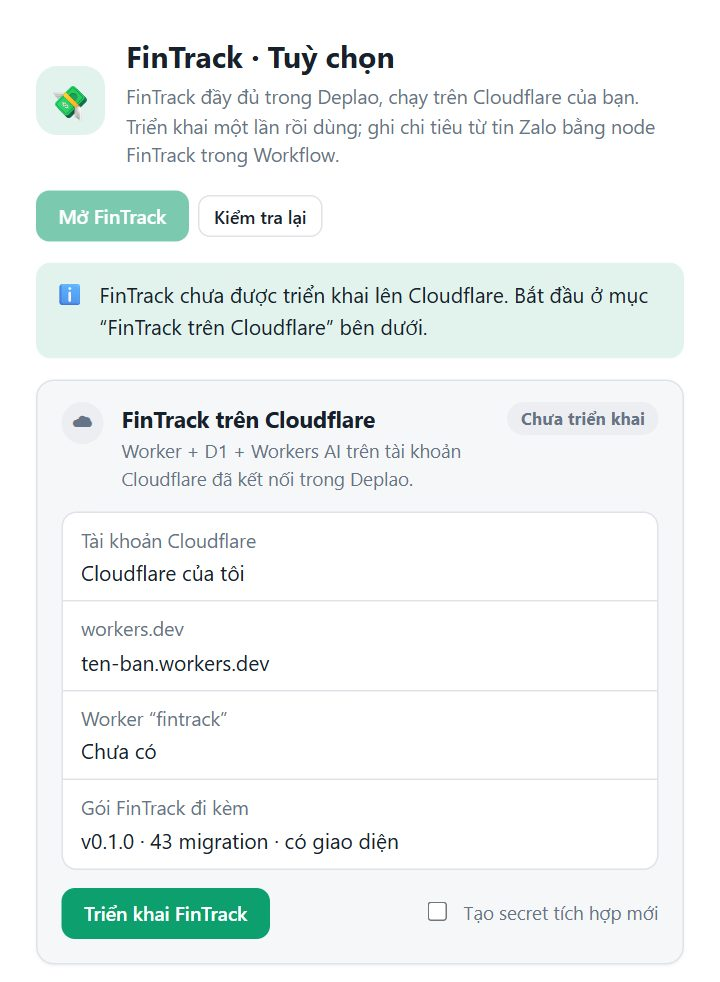<br><sub>1. Trang thiết lập lần đầu</sub></td>
    <td align="center" valign="top">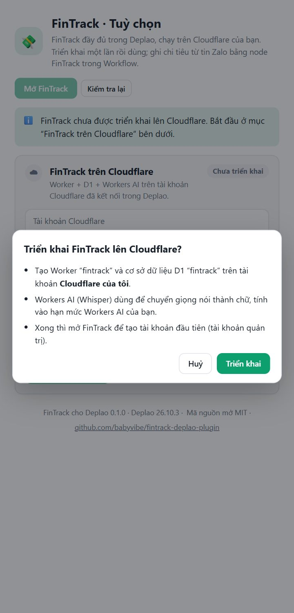<br><sub>2. Xác nhận triển khai</sub></td>
    <td align="center" valign="top">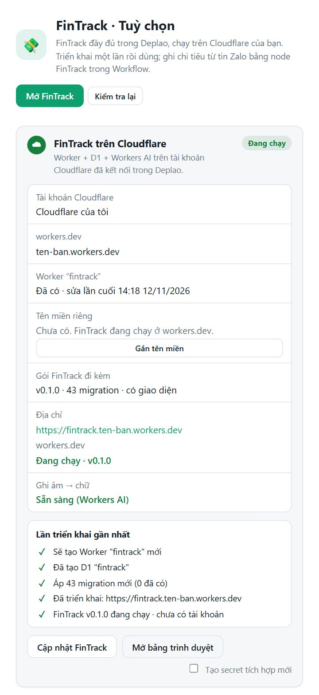<br><sub>3. Triển khai xong</sub></td>
    <td align="center" valign="top">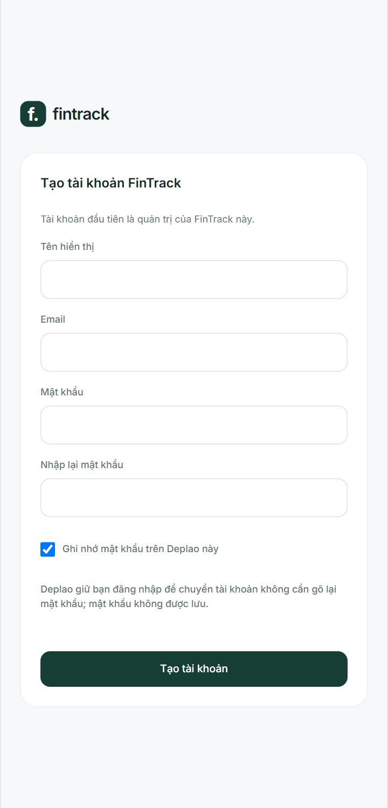<br><sub>4. Tạo tài khoản đầu tiên</sub></td>
  </tr>
</table>

Cập nhật lên bản mới: cài zip mới đè lên, mở trang Tuỳ chọn → **Cập nhật FinTrack** khi trang báo có bản FinTrack mới
(xem [CHANGELOG](CHANGELOG.md)). Dữ liệu D1 và secret giữ nguyên, chỉ áp migration còn thiếu; phải tick xác nhận trước
khi cập nhật Worker đang có.

**Tên miền riêng** (Deplao 26.10.4 trở lên): Tuỳ chọn → FinTrack trên Cloudflare → dòng *Tên miền riêng* → **Gắn tên
miền** → nhập tên con (vd `fintrack`) và chọn tên miền đang có trên Cloudflare của bạn → bấm **Gắn tên miền** ở hộp
thoại của Deplao. Cloudflare tự tạo bản ghi DNS và chứng chỉ (thường 1 đến 5 phút); trong lúc chờ FinTrack vẫn chạy ở
workers.dev, tên mới trả lời được thì ứng dụng tự chuyển sang. Chỉ gắn được tên con chưa có bản ghi DNS. Ô *Địa chỉ
FinTrack* trong Cài đặt ứng dụng **không tạo tên miền**: chỉ điền khi bạn tự triển khai FinTrack ở nơi khác.

<p align="center">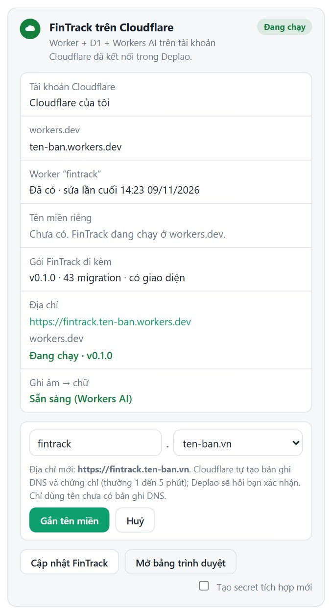<br><sub>Tuỳ chọn → FinTrack trên Cloudflare → Tên miền riêng</sub></p>

<table>
  <tr>
    <td align="center" valign="top">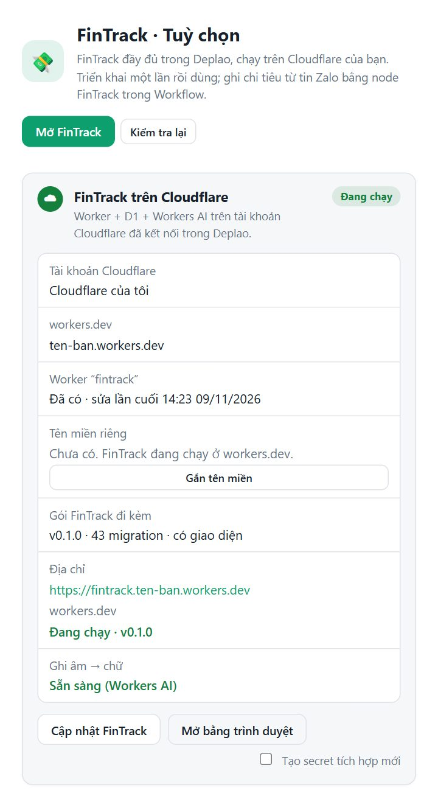<br><sub>Tuỳ chọn → FinTrack trên Cloudflare</sub></td>
    <td align="center" valign="top">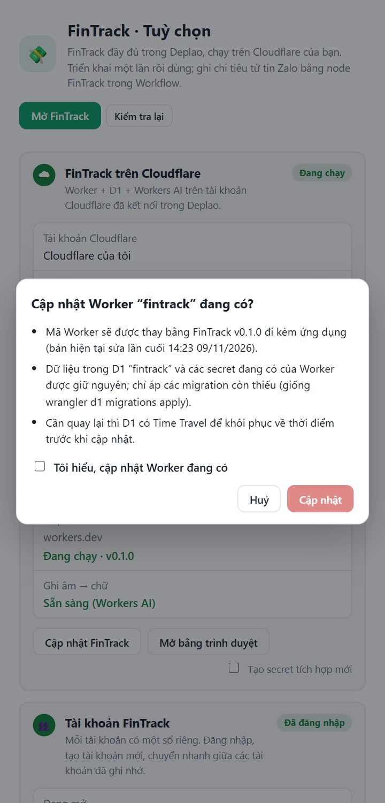<br><sub>Cập nhật FinTrack (giữ dữ liệu)</sub></td>
  </tr>
</table>

## Hướng dẫn sử dụng

### Tài khoản

- **Nút tài khoản** (chữ cái đầu, góc trên FinTrack): chuyển nhanh giữa các tài khoản đã ghi nhớ, *Thêm tài khoản*
  (đăng nhập tài khoản khác hoặc **Tạo tài khoản mới**, sổ riêng), *Đăng xuất* (về màn chọn tài khoản, không tự đăng
  nhập lại).
- Ô **“Ghi nhớ mật khẩu trên Deplao này”** (mặc định bật): Deplao giữ phiên đăng nhập của tài khoản đó để chuyển qua lại
  không phải nhập lại mật khẩu. Mật khẩu **không** được lưu; bỏ ghi nhớ (× hoặc *Quên*) thì lần sau phải đăng nhập lại.
- Trang **Tuỳ chọn** → mục *Tài khoản FinTrack* làm được các việc trên: *Mở* / *Quên* tài khoản đã ghi nhớ, *Thêm tài
  khoản* (mở thẳng màn đăng nhập / tạo tài khoản), *Đăng xuất*.
- **Chia sẻ FinTrack cho người khác:** trang **Tuỳ chọn** → mục *Chia sẻ FinTrack* (trên cùng) → *Sao chép* địa chỉ (tên
  miền riêng, không có thì workers.dev) rồi gửi đi; mở được trên trình duyệt hoặc điện thoại. Muốn họ tự tạo tài khoản:
  bật *Cho người khác tự tạo tài khoản* ở đó (mặc định tắt; cần đang mở tài khoản quản trị, tức tài khoản tạo đầu tiên),
  trang đăng nhập sẽ có *Tạo tài khoản mới*, mỗi người một sổ riêng; *Tối đa tài khoản* giới hạn số tài khoản (0 = không
  giới hạn). Khi tắt, địa chỉ chỉ để đăng nhập tài khoản đã có: tài khoản quản trị vào FinTrack → Cài đặt → **Tài
  khoản** → *Thêm tài khoản* → gửi mật khẩu tạm (chỉ hiện một lần), người dùng đổi mật khẩu ngay lần đầu. Giới hạn tài
  khoản mỗi mạng / giờ, lượt AI / ngày, đặt lại mật khẩu, khoá / mở khoá ở cùng trang đó.

<table>
  <tr>
    <td align="center" valign="top">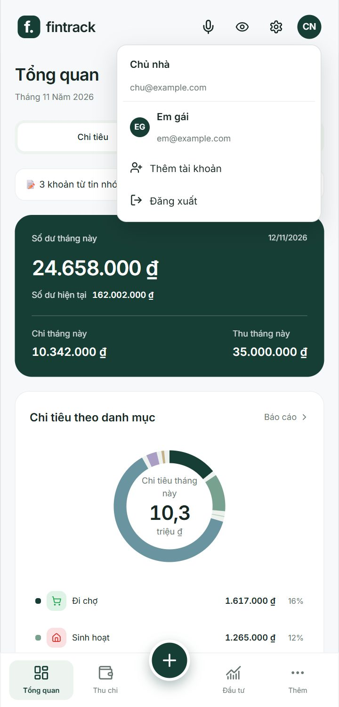<br><sub>Chuyển nhanh giữa tài khoản</sub></td>
    <td align="center" valign="top">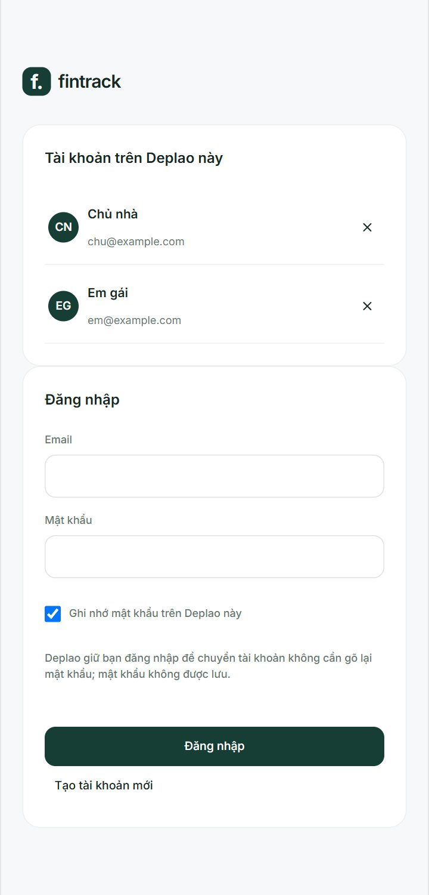<br><sub>Tài khoản đã ghi nhớ · đăng nhập</sub></td>
    <td align="center" valign="top">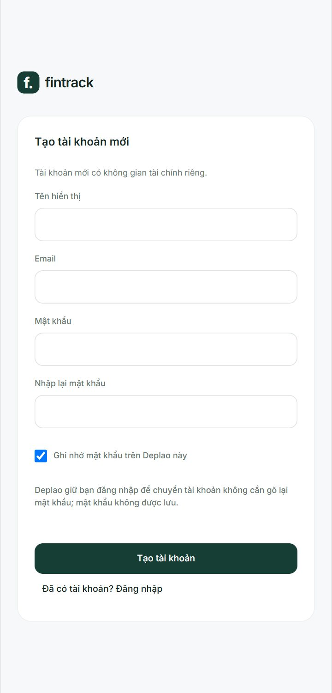<br><sub>Tạo tài khoản mới (sổ riêng)</sub></td>
    <td align="center" valign="top">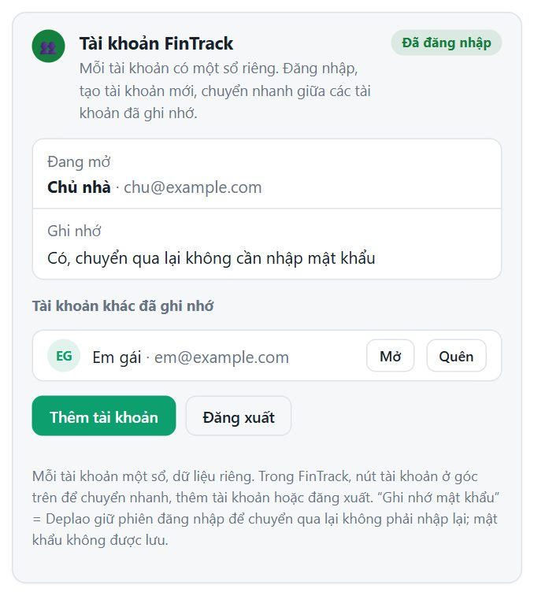<br><sub>Tuỳ chọn → Tài khoản</sub></td>
  </tr>
</table>

### Trợ lý AI

FinTrack → Cài đặt → **Trợ lý AI** có một danh sách chung:

- **Trợ lý của FinTrack**: hồ sơ OpenAI / Gemini / DeepSeek bạn thêm (cần API key). Chạy y như FinTrack bản riêng: đọc ảnh hoá
  đơn, ghi âm theo thiết lập, giới hạn lượt / ngày. Gemini: tạo key ở [Google AI Studio](https://aistudio.google.com/apikey),
  model mặc định `gemini-3.8-flash`; key ở gói miễn phí thì Google có thể dùng nội dung để cải thiện sản phẩm, gói trả phí
  thì không.
- **Trợ lý của Deplao**: *Mặc định của Deplao* hoặc một trợ lý cụ thể. Không cần key riêng; nhận chữ và giọng nói,
  **chưa đọc được ảnh**.

Lựa chọn lưu theo tài khoản và áp dụng cho cả chat trong FinTrack lẫn tin Zalo (node workflow) ghi vào sổ đó.

Mỗi trợ lý hiện **token đã dùng**: thẻ trợ lý của FinTrack có Token hôm nay / Token tháng này (kèm số lượt), danh sách
trợ lý ghi số token tháng này, kể cả trợ lý của Deplao khi ghi từ nhóm Zalo. Token là phần nhà cung cấp AI tính tiền.

<table>
  <tr>
    <td align="center" valign="top">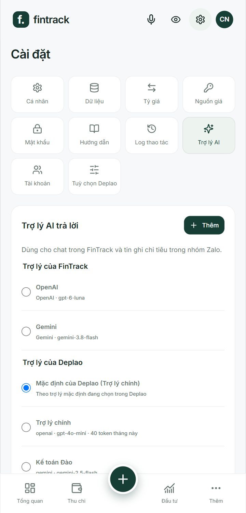<br><sub>Cài đặt → Trợ lý AI</sub></td>
    <td align="center" valign="top"><br><sub>Một câu → bản nháp, bấm Xác nhận để ghi</sub></td>
  </tr>
</table>

### Ghi chi tiêu từ tin Zalo (tuỳ chọn)

Không có bước chọn hay tạo nhóm trong ứng dụng: triển khai FinTrack xong là dùng được, phần ghi từ Zalo là một node trong
**Workflow** của Deplao.

1. Deplao → **Workflow** → tạo workflow: trigger *Tin nhắn* (lọc đúng nhóm hoặc hội thoại cần ghi, nhận chữ, ghi âm,
   ảnh) → thêm node **FinTrack: ghi chi tiêu từ tin nhắn**.
2. Chọn trong node: **chế độ ghi** (*bản nháp chờ xác nhận*, mặc định, hoặc *tự ghi* khoản chắc chắn), trả lời trong nhóm,
   nhận ghi âm, nhận ảnh, trợ lý (xem [Node workflow](#node-workflow)).
3. Khoản ghi vào **tài khoản FinTrack đang mở** trong Deplao. Mọi thành viên trong nhóm đều nhắn được; tài khoản Zalo
   chạy workflow trả lời như một bot.
4. Xác nhận ngay trong nhóm: người gửi khoản đó (hoặc bạn, chủ sổ) **trả lời tin của trợ lý** bằng *ok* (ghi) hoặc *huỷ*
   (bỏ bản nháp; khoản đã ghi thì đảo lại). Nhắn *ok* / *huỷ* ngay sau tin của mình (trong 30 phút) cũng được, không cần
   trích dẫn. Thiếu thông tin (vd chưa có danh mục) thì trợ lý nói rõ chỗ thiếu.
5. Hoặc trong FinTrack: Tổng quan hiện *N khoản từ tin nhóm chờ xác nhận* → **Chờ xác nhận**: chọn ngay chỗ trợ lý chưa
   chắc (thu hay chi, danh mục, ví, ngày), *Sửa*, *Xác nhận* hoặc *Bỏ qua*.

<p align="center">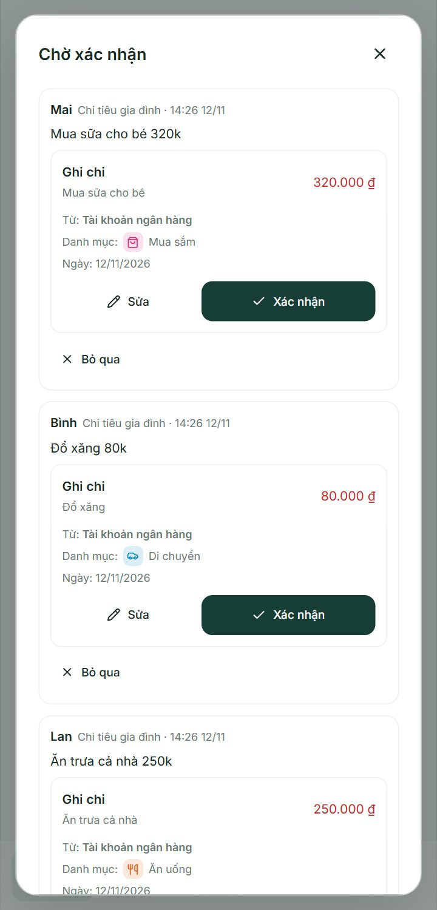<br><sub>FinTrack → Tổng quan → Chờ xác nhận (có cả trên tên miền riêng)</sub></p>

Địa chỉ FinTrack (tên miền riêng) và secret tự đặt nằm ở *Cài đặt* của ứng dụng trong Deplao.

## Node workflow

**`fintrack.record`**: “FinTrack: ghi chi tiêu từ tin nhắn”. Tin chữ, ghi âm hoặc ảnh → trợ lý AI của FinTrack (một
hội thoại riêng cho mỗi nhóm, nội dung `Người gửi: <tên>\n<tin>`), ghi vào tài khoản FinTrack đang mở trong Deplao.

<p align="center">
  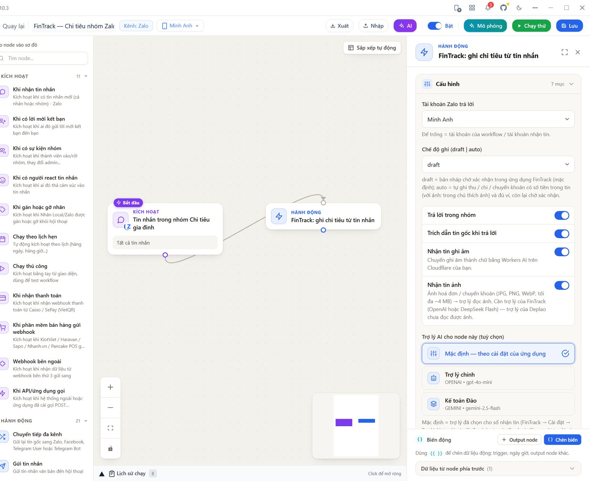
  <br><sub>Workflow có node FinTrack trong trình soạn workflow của Deplao: thêm / sửa như workflow bình thường.</sub>
</p>

| Cấu hình | Mặc định | Ý nghĩa |
|---|---|---|
| `account` | tài khoản của workflow | Tài khoản Zalo trả lời. |
| `mode` | `draft` | `draft`: bản nháp chờ xác nhận (“ok” trong nhóm hoặc Chờ xác nhận trong FinTrack). `auto`: tự ghi thu / chi / chuyển khoản có số tiền trong tin (ảnh: trong chú thích), đủ ví và danh mục, trợ lý không chưa chắc chỗ nào; sai thì trả lời “huỷ”; còn lại chờ xác nhận. |
| `replyInGroup` | `true` | Trả lời trong nhóm (📝 / ✅ / ❓ / ↩️). |
| `quoteReply` | `true` | Trích dẫn tin gốc. |
| `voice` | `true` | Nhận tin ghi âm. |
| `images` | `true` | Nhận tin ảnh (JPG / PNG / WebP ≤ ~4 MB); cần trợ lý của FinTrack đọc được ảnh. |
| `assistantId` | *Mặc định* | Ô chọn trợ lý: *Mặc định* = trợ lý đã chọn cho sổ; chọn một trợ lý Deplao thì node luôn dùng trợ lý đó (không đọc được ảnh). |

Kết quả: `recorded` (số khoản đã ghi), `drafts` (số khoản chờ xác nhận), `items`, `text`, `reply`, `skipped`: rỗng khi
đã xử lý, hoặc lý do: `no_message`, `no_amount`, `not_transaction`, `unclear`, `duplicate`, `own_reply`,
`voice_disabled`, `voice_failed`, `empty_transcript`, `images_disabled`, `image_unsupported_ai`, `image_failed`,
`unsupported_message`, `ai_error`, `fintrack_error`, `not_configured`, `not_allowed` / `already` / `draft_gone` (lệnh
“ok” / “huỷ” không áp dụng được), `internal_error` (lỗi ngoài dự kiến, xem nhật ký của ứng dụng trong Deplao).

- Tin chữ không nhắc tới tiền bị bỏ qua ngay (không gọi AI, không ghi gì).
- “ok” / “huỷ” chỉ là lệnh khi cả tin là lời đó (thêm “ạ”, “nhé”… vẫn được). Trả lời có trích dẫn tin của trợ lý thì nhận
  thêm lời ngắn (“ừ”, “đúng”, “sai”, 👍); không trích dẫn thì chỉ nhận lời rõ nghĩa, áp cho tin gần nhất của chính người
  gửi. Thành viên khác trả lời tin của trợ lý thì được nhắc chỉ người gửi hoặc chủ sổ mới xác nhận được.
- Mỗi tin Zalo chỉ xử lý một lần (nhớ 7 ngày), kể cả khi nhiều tài khoản Zalo của bạn cùng ở trong nhóm.
- Tin trả lời của chính ứng dụng (✅ ❓ ⚠️ 🎙️ 📝 ↩️) không bao giờ bị xử lý lại.
- Lỗi tạm thời (FinTrack / trợ lý không phản hồi) báo trong nhóm tối đa một lần mỗi 10 phút; chưa thiết lập xong (chưa
  triển khai, secret sai…) thì bỏ qua im lặng, trang Tuỳ chọn hiện lỗi cho bạn.

**`fintrack.transcribe`**: “FinTrack: ghi âm thành chữ” (Workers AI Whisper). Kết quả `text`, `durationSec`, `skipped`.

## Quyền ứng dụng xin

| Quyền | Để làm gì |
|---|---|
| `cloudflare:workers` | Triển khai Worker + D1 tên `fintrack` (chỉ tài nguyên mang tên của ứng dụng); gắn tên miền con cho Worker đó khi bạn đồng ý ở hộp thoại của Deplao. |
| `network` | Gọi Worker FinTrack của bạn; tải ghi âm / ảnh từ CDN Zalo khi Deplao chưa tải được. |
| `storage` | Địa chỉ, secret tích hợp, phiên đăng nhập theo tài khoản, tài khoản ghi nhớ, lựa chọn trợ lý, tin trả lời nào trong nhóm ứng với bản nháp nào (cho “ok” / “huỷ”). |
| `ui:pages` | Trang “FinTrack”. |
| `ui:microphone` | Ghi âm khi bạn bấm micro trong trợ lý AI của FinTrack (chỉ khung giao diện của ứng dụng). |
| `ai:use` | Khi dùng trợ lý của Deplao: gọi trợ lý đó và đọc danh sách trợ lý để chọn. |
| `workflow:nodes` | Node `fintrack.record`, `fintrack.transcribe` (ứng dụng không tạo hay sửa workflow của bạn). |
| `accounts:read`, `chat:read`, `chat:send`, `media:read` | Nhận ra tin trả lời của chính ứng dụng, đọc + tải ghi âm / ảnh, trả lời trong nhóm. |

## Quyền riêng tư & bảo mật

- Không có máy chủ trung gian: giao diện → backend ứng dụng (trên máy bạn) → Worker FinTrack của bạn (HTTPS).
- Trợ lý AI: FinTrack dựng prompt + ngữ cảnh như bản riêng. Trợ lý của FinTrack gọi thẳng OpenAI / Gemini / DeepSeek từ Worker
  của bạn; trợ lý của Deplao nhận prompt qua backend ứng dụng. Mọi ghi sổ vẫn qua API nghiệp vụ của FinTrack (kiểm tra
  lại ví, danh mục, số tiền).
- Ghi âm: Deplao tải → Worker của bạn → Workers AI trên Cloudflare của bạn. Ảnh: Deplao tải → Worker → nhà cung cấp AI
  của trợ lý FinTrack. Không lưu file âm thanh / ảnh.
- Secret tích hợp và token phiên nằm trong kho riêng của ứng dụng trên máy, không hiện ra giao diện, không ghi nhật ký;
  mật khẩu không bao giờ được lưu; ứng dụng không bao giờ thấy token Cloudflare.

Chi tiết và cách báo lỗ hổng: [SECURITY.md](SECURITY.md).

## Câu hỏi thường gặp

**Tốn tiền không?** Ứng dụng miễn phí. FinTrack chạy trên tài khoản Cloudflare của bạn; với mức dùng cá nhân / gia đình
thường nằm trong gói miễn phí. Theo bảng giá Cloudflare (tháng 10/2026): [D1](https://developers.cloudflare.com/d1/platform/pricing/)
miễn phí 5 triệu hàng đọc + 100.000 hàng ghi mỗi ngày, 5 GB lưu trữ; [Workers AI](https://developers.cloudflare.com/workers-ai/platform/pricing/)
miễn phí 10.000 neurons/ngày (~200 phút ghi âm Whisper); [Workers](https://developers.cloudflare.com/workers/platform/pricing/)
có gói miễn phí theo số request/ngày. Hạn mức ngày đặt lại lúc 07:00 giờ Việt Nam. Trợ lý AI: trợ lý của FinTrack tính
phí theo API key OpenAI / Gemini / DeepSeek của bạn; trợ lý của Deplao dùng cấu hình AI bạn đã có trong Deplao.

**Dữ liệu nằm ở đâu?** Sổ sách nằm trong D1 `fintrack` trên Cloudflare của bạn. Trên máy chỉ có cấu hình của ứng dụng
(địa chỉ, secret tích hợp, phiên đăng nhập, tài khoản ghi nhớ, tin trả lời nào ứng với bản nháp nào) trong kho riêng
của ứng dụng trong Deplao; bản nháp từ nhóm nằm trong D1 cùng sổ sách. Không có máy chủ nào của tác giả ở giữa.

**Mở bằng trình duyệt / điện thoại được không?** Được: mở địa chỉ Worker (nút *Mở bằng trình duyệt* ở trang Tuỳ chọn),
cài như app (PWA). Cùng dữ liệu với bản trong Deplao.

**Gỡ ứng dụng thì sao?** Khi gỡ, Deplao hỏi *Giữ dữ liệu* (cài lại là dùng tiếp) hay *Xoá dữ liệu* (xoá cấu hình trên
máy: secret, phiên, tài khoản ghi nhớ). Cả hai đều **không** đụng tới Cloudflare: Worker và D1
`fintrack` vẫn còn, vẫn mở bằng trình duyệt được. Muốn xoá hẳn sổ sách: sao lưu trước (FinTrack → Cài đặt → Dữ liệu →
Sao lưu) rồi xoá Worker `fintrack` và D1 `fintrack` trong bảng điều khiển Cloudflare. Workflow có node FinTrack của
bạn vẫn nằm trong Deplao: tắt hoặc xoá ở trang Workflow.

**Nhiều người trong nhà dùng chung?** Mỗi người một tài khoản (sổ riêng): ở trang Tuỳ chọn → *Chia sẻ FinTrack*, sao
chép địa chỉ gửi cho họ và bật *Cho người khác tự tạo tài khoản* để mỗi người tự tạo tài khoản. Chi tiêu chung của cả
nhà: một nhóm Zalo đi qua node FinTrack, ghi vào tài khoản đang mở trong Deplao; ai trong nhóm nhắn cũng được ghi, kèm
tên người gửi.

**Số trong app lệch với ví / ngân hàng / sao kê thẻ?** Thu chi → Ghi chi → tab *Điều chỉnh* (hoặc Tài khoản → ⋯ →
*Điều chỉnh số dư*; Đối soát có lệch cũng có nút này): nhập số dư thực tế, FinTrack ghi phần chênh lệch để khớp. Khoản
điều chỉnh không tính là thu nhập hay chi tiêu, không vào ngân sách; ghi nhầm thì *Hủy điều chỉnh* trong Thu chi.

**Đã nạp dữ liệu mẫu, muốn xoá để dùng thật?** FinTrack → Cài đặt → Dữ liệu → *Đặt lại toàn bộ dữ liệu*: xoá mọi dữ liệu
tài chính của tài khoản đang mở (tài khoản tiền, giao dịch, đầu tư, tiết kiệm, ngân sách, chat trợ lý…), giữ đăng nhập,
cài đặt và trợ lý AI, rồi về màn tạo tài khoản tiền đầu tiên. Tài khoản khác không bị ảnh hưởng; không hoàn tác được:
tải bản sao lưu trước nếu cần.

## Xử lý sự cố

| Hiện tượng | Cách xử lý |
|---|---|
| “Gói FinTrack đi kèm thiếu giao diện (vendor/fintrack/app)” | Cài bản phát hành đầy đủ (file zip ở trang phát hành, không phải mã nguồn). |
| “Bản Deplao đang dùng chưa hỗ trợ triển khai lên Cloudflare” / không cài được | Cập nhật Deplao. |
| “Token Cloudflare còn thiếu quyền …” | Tạo lại token bằng link mẫu ở Kết nối Cloudflare. Deplao lưu kết quả kiểm tra ~1 phút. |
| Tổng quan báo “Có bản FinTrack mới”, hoặc tính năng mới chưa chạy (đổi biểu tượng danh mục không lưu, lịch Thu chi không có tổng theo ngày) | Gói FinTrack trong ứng dụng mới hơn bản đang chạy trên Cloudflare (cài bản ứng dụng mới không tự cập nhật Cloudflare). Mở *Tuỳ chọn* → **Cập nhật FinTrack**; dữ liệu giữ nguyên. |
| “Chưa kết nối được FinTrack” ngay sau triển khai | workers.dev mới bật có thể mất vài phút. Bấm *Kiểm tra lại*. |
| Điền *Địa chỉ FinTrack* trong Cài đặt mà không lên tên miền, FinTrack báo không kết nối được | Ô đó không tạo tên miền (và gõ sai một chữ là hỏng). Xoá trống ô đó, rồi gắn ở Tuỳ chọn → FinTrack trên Cloudflare → *Tên miền riêng*. |
| Gắn tên miền báo “đã có bản ghi DNS” / “đang được dùng cho một Worker khác” | Tên con đó đang dùng cho việc khác (website, Địa chỉ Internet của Deplao…): chọn tên khác, hoặc xoá bản ghi đó trên Cloudflare trước. |
| Tên miền riêng mãi “Chờ DNS và chứng chỉ” | Cloudflare thường cần 1 đến 5 phút. Bấm *Kiểm tra* cạnh tên miền; trong lúc chờ FinTrack vẫn chạy ở workers.dev. |
| Dòng *Tên miền riêng* báo cần cập nhật Deplao | Bản Deplao cũ chưa có tính năng này: cập nhật Deplao (26.10.4 trở lên). |
| Mở FinTrack ra màn đăng nhập | Đã đăng xuất, hoặc FinTrack có nhiều tài khoản mà Deplao chưa ghi nhớ tài khoản nào: chọn tài khoản đã ghi nhớ, đăng nhập, hoặc *Tạo tài khoản mới*. |
| “Tài khoản chủ workspace đã bị khoá” | Tài khoản bị quản trị khoá: mở khoá ở FinTrack → Cài đặt → Tài khoản (đăng nhập quản trị), hoặc dùng tài khoản khác. |
| Trợ lý AI báo lỗi | Xem trợ lý đang dùng (FinTrack → Cài đặt → Trợ lý AI). Trợ lý của Deplao: bật + có API key ở Tích hợp → Trợ lý AI. Trợ lý của FinTrack: API key / model ở FinTrack → Cài đặt → Trợ lý AI. Hoặc chọn trợ lý khác. |
| Nhóm nhắn “⚠️ … chưa đọc được ảnh” | Sổ nhận tin đang dùng trợ lý của Deplao (hoặc DeepSeek không phải Flash): chọn trợ lý của FinTrack đọc được ảnh, hoặc gõ chữ. |
| Nhóm nhắn “⚠️ Trợ lý AI đã hết lượt hôm nay…” | Hết giới hạn lượt / ngày của FinTrack (Cài đặt → Trợ lý AI) hoặc nhà cung cấp AI đang giới hạn. Đợi hoặc tăng giới hạn. |
| Nhóm nhắn “⚠️ Trợ lý AI của sổ chưa sẵn sàng…” | Trợ lý của FinTrack đang chọn chưa có API key: thêm key ở FinTrack → Cài đặt → Trợ lý AI, hoặc chọn trợ lý khác cho sổ đó. |
| Trang Tuỳ chọn báo “Ứng dụng có FinTrack … mới hơn bản đang chạy” | Bấm *Cập nhật FinTrack* (dữ liệu giữ nguyên) để dùng tính năng của bản ứng dụng mới. |
| Gửi ảnh vào nhóm nhưng không có gì xảy ra | *Nhận tin ảnh* của node FinTrack đang tắt, hoặc trigger của workflow không nhận ảnh: sửa trong Workflow. Sổ nhận tin cần trợ lý của FinTrack đọc được ảnh. |
| “Dữ liệu FinTrack trả về lớn hơn 5 MB” | Việc lớn (sao lưu, xuất dữ liệu) làm trên FinTrack bằng trình duyệt. |
| Nhóm không phản hồi | Workflow có node FinTrack đang bật? Tài khoản Zalo đang kết nối? Đã mở tài khoản FinTrack trong Deplao? Tin chữ không có số tiền được bỏ qua là bình thường. |

## Phát triển

Không phụ thuộc thư viện ngoài: chỉ cần **Node ≥ 20**, không `npm install`.

```bash
npm test             # toàn bộ test (node:test, không cần Deplao, không mạng)
npm run validate     # manifest, phiên bản khớp nhau, mọi file JSON
npm run check        # cả hai lệnh trên
npm run pack         # → dist/fintrack-<version>.zip  (-- --no-bundle: gói thử không kèm FinTrack)
```

Chạy thử trong Deplao: **Công cụ → Ứng dụng, API & Webhook → Phát triển ứng dụng → Thêm thư mục đang phát triển** →
chọn thư mục repo. Sửa `backend/` thì Deplao tự tải lại; sửa `ui/` thì tải lại trang.

```
backend/            tiến trình ứng dụng (CommonJS, chỉ module có sẵn của Node)
  index.js          điểm vào: nodes + commands
  lib/              proxy, tài khoản, lệnh giao diện, node ghi chi tiêu từ tin Zalo, triển khai, lưu trữ…
ui/                 trang vào + trang Tuỳ chọn (HTML/CSS/JS thuần, không script inline)
vendor/fintrack/    gói FinTrack dựng sẵn (không commit, xem bên dưới)
scripts/            đóng gói, kiểm tra manifest, chép gói FinTrack, kiểm thử đầu-cuối, xem thử
test/               node:test + bản giả của Deplao / FinTrack (test/helpers/fakes.js)
docs/               ARCHITECTURE.md, CONTRACTS.md (hợp đồng giữa Deplao · FinTrack · ứng dụng)
```

**Gói FinTrack đi kèm.** Bản phát hành chứa bản build của [FinTrack](https://github.com/babyvibe/fintrack) (Worker,
giao diện web, migration D1, giao diện bản Deplao) trong `vendor/fintrack/`; thư mục này không nằm trong git. Muốn
triển khai được khi phát triển, chọn một trong hai:

- build FinTrack (`npm run bundle:deplao` trong repo FinTrack) rồi `npm run vendor`
  (xem [vendor/fintrack/README.md](vendor/fintrack/README.md));
- hoặc lấy sẵn từ bản phát hành: giải nén `fintrack-<phiên bản>.zip`, rồi
  `npm run vendor -- --from <thư mục giải nén>/vendor/fintrack`.

Không có gói vẫn chạy test, sửa giao diện / node bình thường.

**Kiểm thử đầu-cuối và xem thử** (cần mã nguồn FinTrack ở `../fintrack` hoặc `FINTRACK_DIR`, đã `npm install`):

```bash
npm run e2e                  # FinTrack THẬT (API + D1 trong Miniflare) + Deplao giả: proxy, tài khoản, trợ lý, node nhóm
npm run preview              # giao diện ở http://127.0.0.1:4319 với SDK Deplao giả
                             #   -- --fresh: FinTrack chưa có tài khoản · --demo: có nhóm Zalo + bản nháp mẫu
                             #   -- --undeployed: như lần cài đầu (bấm "Triển khai FinTrack")
npm run shots                # chụp lại ảnh tài liệu docs/images/*.jpg (Node ≥ 22 + Chrome / Edge)
```

Ảnh `docs/images/zalo-group.jpg` và `deplao-workflow.jpg` chụp từ giao diện Deplao (dữ liệu mẫu); các ảnh còn lại do
`npm run shots` tạo từ bản xem thử; địa chỉ hiện ra là `fintrack.ten-ban.workers.dev`, không phải Worker thật nào.

Tài liệu cho người phát triển (tiếng Anh): [README.en.md](README.md#development), [CONTRIBUTING.md](CONTRIBUTING.md),
[docs/ARCHITECTURE.md](docs/ARCHITECTURE.md), [docs/CONTRACTS.md](docs/CONTRACTS.md) và
[docs/BUILDING_APPS.md](docs/BUILDING_APPS.md) (dựng app Deplao mới theo khuôn repo này).

## Đóng góp

Rất hoan nghênh issue và pull request: đọc [CONTRIBUTING.md](CONTRIBUTING.md) (quy ước, chạy thử, phát hành) và
[CODE_OF_CONDUCT.md](CODE_OF_CONDUCT.md). Lỗ hổng bảo mật: báo riêng theo [SECURITY.md](SECURITY.md).

## Giấy phép

[MIT](LICENSE) © 2026 babyvibe. Bản phát hành kèm gói FinTrack (MIT) cùng giấy phép của các thư viện bên thứ ba trong
`vendor/fintrack/` (`LICENSE`, `THIRD_PARTY_NOTICES.md`, `THIRD_PARTY_LICENSES.md`).

